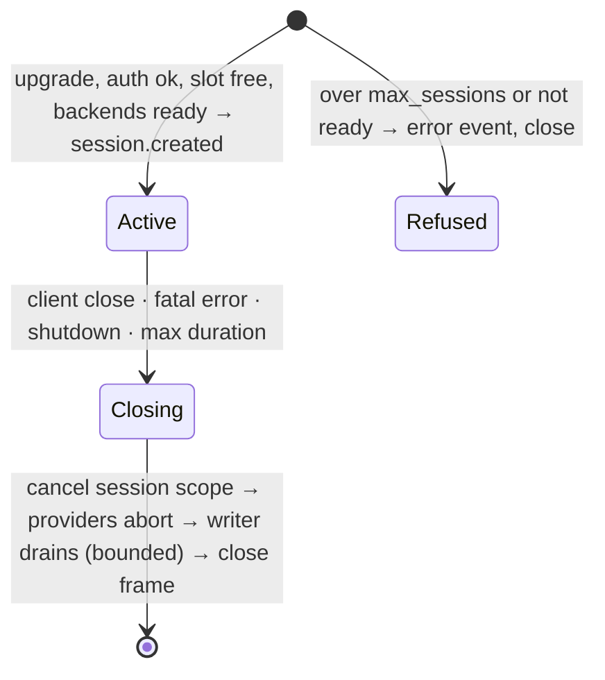
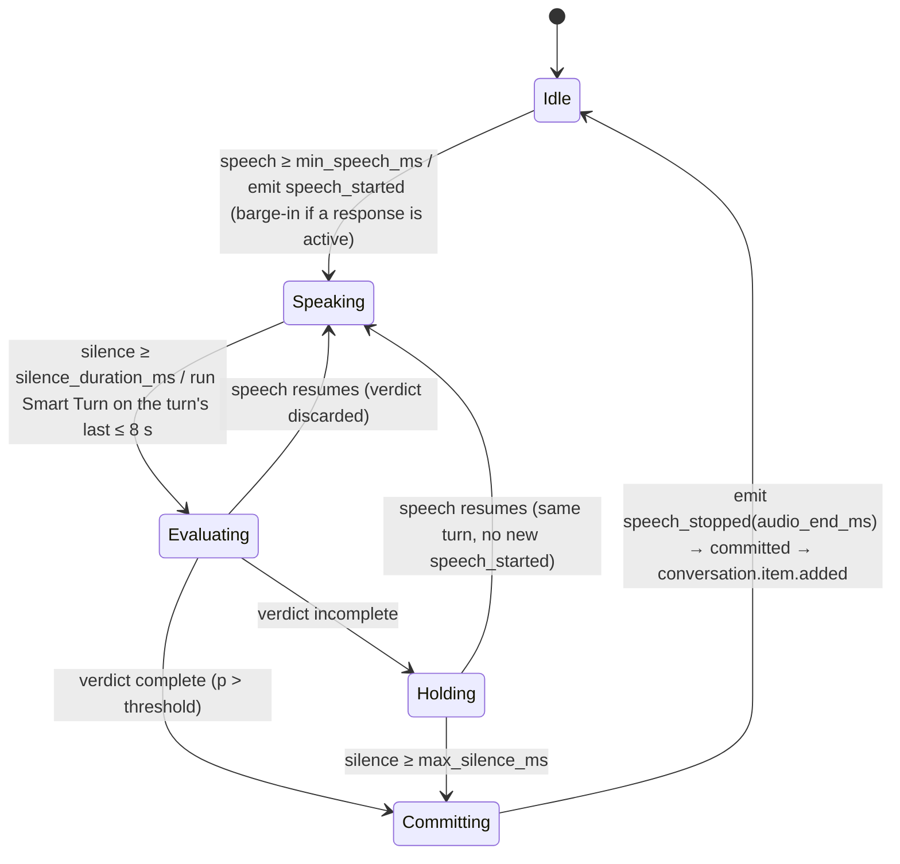
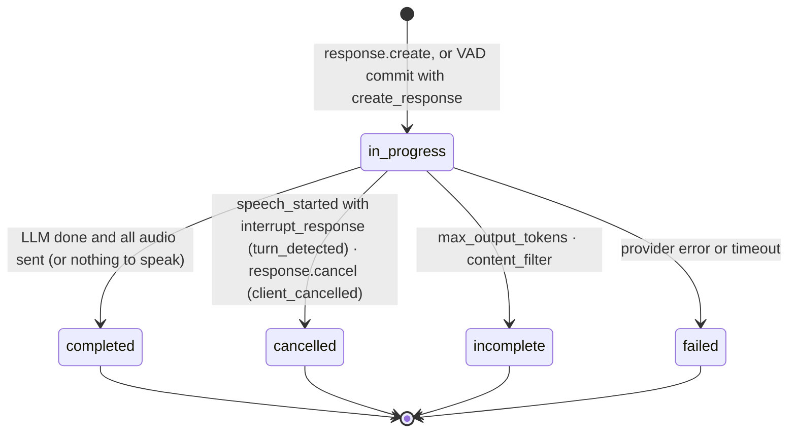

# mlx-realtime — Architecture

> **Status: implemented (synced 2026-10-24).** M0–M7 are built, followed by the LLM hardening, the
> G7 dual-path echo cancellation and the first real-stack validation (`docs/PROGRESS.md`). Decisions
> D1–D19 were approved on 2026-10-22; D13 and D17 were settled since (§12), and later decisions are
> in `docs/DECISIONS.md`.
> **[M0]** marks a fact or choice the M0 spikes (`docs/SPIKE.md`) were to confirm; their findings are
> there. **[D#]** points to a decision in §12. Milestones are in §13, and sources in §14.

## 1. Purpose and priorities

mlx-realtime is a local voice service for Apple Silicon (M3 Max, 128 GB). Externally it speaks a
documented subset of the OpenAI Realtime API (GA) over WebSocket at `/v1/realtime`; the official
`openai` Python SDK connects by changing only `base_url`. Internally it is a cascade — VAD → turn
detection → ASR → LLM → TTS — for Chinese, English and code-switched speech.

**Clients.**

- **ai-native-callcenter (AICC)** is the integration target. Its existing Realtime client
  (`internal/provider`, GA style) connects to `/v1/realtime` exactly as it connects to OpenAI, and it
  carries FreeSWITCH calls. mlx-realtime attaches first through AICC's existing `gateway` profile,
  with no AICC change, and later through a profile of its own (§2, D11).
- **The official `openai` Python SDK** is the conformance client required by the brief.
- **The benchmark.**

**cascade-realtime-gateway** (`../cascade-realtime-gateway`) is a design reference only, not a client
of this service. mlx-realtime reuses its protocol decisions and lessons where they are GA-faithful.

The protocol layer and the model layer are separated by explicit, swappable interfaces.

When goals conflict they rank:

1. Latency from the end of user speech to the first audio sent.
2. Deterministic barge-in, cancellation and truncation.
3. Reliability: a failed request never takes down its session; a failed session never takes down the process.
4. Observability: every stage of every turn is timed.
5. Single-command deployment.
6. Clear component boundaries.

Out of scope: WebRTC/SIP transports, Docker (Metal is unavailable in containers on macOS), multiple
machines, persistence, server-side tool execution, full Realtime parity.

## 2. Process topology

```
  Realtime clients: ai-native-callcenter (FreeSWITCH calls) · openai SDK · bench
         │ ws://<host>:8000/v1/realtime?model=…   Authorization: Bearer <key>
         ▼
 ┌───────────────── gateway · Python 3.12 · asyncio · uvicorn + starlette ─────────────────┐
 │ WS transport → GA protocol adapter → session actors → per-response pipelines            │
 │ echo cancellation: WebRTC AEC3 + vendored SpeexDSP (CPU executor)                       │
 │ Silero VAD + Smart Turn (onnxruntime, CPU executors)                                    │
 │ resampling · G.711 · sentence segmenter · text normalizer · metrics                     │
 │ /healthz  /readyz  /metrics  /debug/turns (off)      (no MLX installed in this env)     │
 └──────┬──────────────────────────────┬─────────────────────────────────┬─────────────────┘
        │ HTTP                         │ HTTP + SSE                      │ HTTP, chunked PCM
        ▼                              ▼                                 ▼
 ┌──────────────────┐        ┌────────────────────┐          ┌───────────────────────────┐
 │ asr   :8102      │        │ llm   :8101        │          │ tts   :8103               │
 │ mlxrt_audio.serve│        │ mlxrt_llm.serve    │          │ mlx_audio.server          │
 │ Qwen3-ASR-1.7B   │        │ (mlx_lm.server)    │          │ Qwen3-TTS-0.6B 8-bit      │
 │ 8-bit            │        │ Qwen3.6-35B-A3B    │          │ + 4-bit fallback (D13)    │
 └──────────────────┘        └────────────────────┘          └───────────────────────────┘
   one MLX thread per process; the three processes share the GPU and unified memory
   capacity: at most 3 concurrent calls, bound by the TTS (one stream at a time)
```

| Process | Runs | Owns | Environment | Default bind |
|---|---|---|---|---|
| gateway | `python -m mlx_realtime serve` | protocol, sessions, echo cancellation, VAD and turn detection, segmentation, normalization, barge-in, metrics | root uv project; no `mlx*` packages | 127.0.0.1:8000, configurable (AICC runs on another host or in Docker) |
| llm | `python -m mlxrt_llm.serve --model <pinned snapshot> --chat-template-args '{"enable_thinking":false}' --max-tokens 2048 --temp 0.7 --top-p 0.8 --top-k 20 --min-p 0.0 --prompt-cache-size 64 --prompt-cache-bytes 8GB --tools-checkpoint --shared-prefix-checkpoint` | LLM weights, KV and prompt cache (64 cached prompts, ~100 MB each) | `backends/llm` uv project, package `mlxrt_llm`: `mlx_lm.server` with a lenient qwen3_coder tool-call parser and prompt-cache checkpoints, guarded to mlx-lm 0.32.2 (§5.3) | 127.0.0.1:8101 |
| asr | `python -m mlxrt_audio.serve` (`mlx_audio.server` with the `context` patch, §5.3) | Qwen3-ASR-1.7B-8bit | `backends/audio` uv project (mlx-audio 0.6.1) | 127.0.0.1:8102 |
| tts | `mlx_audio.server` (stock, G1) | Qwen3-TTS-0.6B-CustomVoice 8-bit (primary) and 4-bit (fallback, D13) | `backends/audio` uv project | 127.0.0.1:8103 |

`mlxrt dev` starts each backend as `uv run --locked --project <project> <command> --host <host>
--port <port> [--model <local snapshot>] <args>`, from `backends` in `config.yaml` (§10). Every model
is pinned by revision and fetched ahead of time (`mlxrt models --mlx`); the backends run with
`HF_HUB_OFFLINE=1`.

**Capacity.** At most 4 concurrent sessions (`gateway.max_sessions: 4`; the owner's target for this
development Mac was 3 calls, raised on 2026-10-24 for AICC's human-call transcription, issue #2:
each human call opens two transcription sessions), with one process per backend. A transcription
session (`session.type: "transcription"`, PROTOCOL §3.1) asks the ASR for each utterance and nothing
else: no LLM, no TTS, no Silero, Smart Turn or canceller. The LLM batches requests (`max_in_flight`
5: one response per session at most, plus a prompt-cache warm-up), and the ASR takes 4 at once. The
TTS server synthesizes one stream at a time, so the bot calls share it through a gateway-side queue
(§4.4, §7), and that queue is the capacity limit of bot calls. One call meets AICC's deadlines with
margin. Three bot calls do not reliably meet them: first segments wait up to 1.9 s for the TTS (G4,
`docs/LATENCY.md` §4). More TTS capacity is an open owner decision (`docs/DECISIONS.md`,
2026-10-24). Two busy transcription sessions cost the bot calls nothing measurable (`docs/LATENCY.md` §3.8).
A transcription session never sends non-speech to the ASR: a voiced commit goes through a Silero
speech check first (`transcription.min_speech_ms`), and every ASR request carries a `max_tokens` in
proportion to its audio (`providers.asr.token_cap`), because Qwen3-ASR copies its prompt or runs to
its token limit on hold music and DTMF, and the backend does not stop when the gateway gives up.

**What the desk check found** (mlx-lm 0.32.2, mlx-audio 0.6.1; confirmed hands-on in M0 and the
real-stack validation):

- **Both backends keep MLX on one thread.**
  - `mlx_lm.server` runs every MLX call on a single generation thread and batches requests
    continuously.
  - `mlx_audio.server` serializes HTTP inference on one broker thread. Its WebSocket routes and
    `POST /v1/models` run MLX on the asyncio thread instead, so the gateway uses only its HTTP routes.
- **`mlx_audio.server` loads each requested model lazily** and has no preload or pinning. The gateway's
  warmup request is what loads the model, after every start of the process.
- **mlx_lm.server's generation thread can die,** and nothing restarts it. `/health` then returns 503,
  and the supervisor must restart the process.
- **Running several MLX processes on one GPU has open bug reports:** occasional hangs, and IOGPU
  kernel panics on macOS 26 under high memory pressure. The 30-minute soak on the real stack (S6) saw
  no hang, crash, backend error or GPU kernel message, and memory stayed flat, so the three processes
  stay (G6). A backend that dies is restarted by the supervisor (Supervision, below), and the gateway
  warms it again when it is back (§8).

**Separate environments [D10].** Each `backends/<role>/` is an independent uv project.

- It is created with `uv init --no-workspace`, and has its own `uv.lock` and uv-managed environment.
- It is started with `uv run --locked --project backends/<role> …`.
- The gateway environment does not contain `mlx`, `mlx-lm` or `mlx-audio`. "The gateway loads no MLX
  models" therefore holds by construction.
- mlx-lm and mlx-audio can pin different `mlx`/`transformers` versions without a resolver conflict.
- The uv rules for the whole repository are in §3.

**The model processes are internal.**

- They bind to 127.0.0.1, and their only client is the gateway's providers (§5). Their HTTP
  contracts (§5.3) are whatever those backends already speak, so nothing outside this repository
  depends on them.
- Thinking is off server-wide (`--chat-template-args`) and again per request, so neither setting alone
  can turn it back on.

**AICC integration [D11].** AICC attaches a Realtime engine as a profile.

- mlx-realtime targets the traits of AICC's existing `gateway` profile, so the first integration needs
  no AICC change at all:
  - `AICC_PROVIDER=gateway`
  - `AICC_PROVIDER_ENDPOINT=ws://<host>:8000/v1/realtime`
  - `REALTIME_API_KEY=<key>`
- A dedicated profile can come later; AICC adds it in its own repository. It would set
  `AcceptsG711: true` (G.711 passthrough, supported since M7) and enable `tool_choice`.

AICC's client requirements, from an audit of its `internal/provider` on 2026-10-22. Its client
frames are in `spikes/aicc/traces/`.

| Area | Requirement |
|---|---|
| Handshake | The upgrade completes within 3 s, and `session.updated` arrives within 3 s of the first `session.update`. No `error` may come before it, or the call fails. |
| Session shape | GA, with `audio/pcm` at 24 kHz both ways. `turn_detection` carries only `{type: server_vad, silence_duration_ms: 500}`, so every other field takes its default. Tools are flat function tools. An optional flow-chosen `voice` must never be rejected. Later updates carry only `instructions`. |
| Turn-taking | AICC never commits and never requests a reply to caller speech. The server emits the speech events and creates exactly one reply per speech turn. A turn without a reply leaves AICC's owed turns held. |
| Deadlines | `response.created` ≤ 3 s after `response.create`. The first `response.output_audio.delta` ≤ 3 s after `response.created`. Gaps between audio deltas < 2 s. A tool-only response reaches `response.done` ≤ 3 s after `response.created`. A missed deadline silently abandons the turn. |
| One response at a time | A second `response.create` is refused with code `conversation_already_has_active_response`, not queued. |
| Barge-in | The server cancels its own response: `speech_started` first, then `response.done{status: cancelled}`. It replies after `speech_stopped`. |
| Client edits | `response.cancel` with no id. `conversation.item.truncate` with the played ms of the response. `conversation.item.delete` for unheard items and for tool calls made in a line's turn. User `input_text` notes (keypress, dead air, system notes). A `function_call_output` whose JSON carries a `hint`. |
| Lines | `response.create {response: {instructions: "Say exactly this, word for word, and add nothing else:\n…"}}`, or the Chinese equivalent. This can arrive on an empty conversation. |
| Transcripts | One `conversation.item.input_audio_transcription.completed` per caller utterance, without being asked. |
| Errors | Only a lost socket is fatal. But an unexpected `error` makes AICC forget an in-flight request, so errors are sent only where required, with OpenAI's codes (D18). |
| Audio | 20 ms appends (960 B), sent continuously, including while the bot speaks; AICC has no echo cancellation. Output deltas can be any whole-sample size and arrive faster than real time; AICC queues up to 30 s of them. |

**Startup, warmup, readiness.**

- Processes start independently, with no start-order dependency. The LLM backend loads its model at
  start; `mlx_audio.server` loads a model when the gateway's warmup first asks for it.
- The gateway warms every backend at once, each as soon as it answers, retrying one that is not up
  yet with exponential backoff (0.5 s to 5 s):
  - LLM: a one-token completion with the default instructions, which also seeds the prompt cache.
  - ASR: a bundled 1 s clip.
  - TTS: one Chinese and one English sentence per configured voice on the primary, and the default
    voice on the fallback.
  - Silero and Smart Turn: one inference each.
- On the real stack the gateway was ready 13.3 s after it started (warm page cache).
- `/healthz` reports whether the gateway's event loop is responsive. It makes no backend calls.
- `/readyz` reports, with per-backend detail, whether every backend answers ready **and** is warm;
  `mlxrt_backend_ready` on `/metrics` follows the same rule.
- Until the first successful readiness, a new connection receives an `error` event (`server_error`,
  code `not_ready`) and is closed (1013). After that, connections are accepted; backend failures
  surface per response (§8) and on `/readyz`.
- After the startup warmup the readiness monitor keeps the backends warm: it probes each warm
  backend every 5 s, and warms one that answers "not ready" again, with the same retries, until it
  is ready (§8, Backend health).

**Supervision.**

- `make dev` runs `uv sync --locked` and fetches the ONNX models, then runs `uv run --locked mlxrt
  dev`, a small supervisor in the gateway package. It:
  - reads `config.yaml` and starts the three backends and the gateway;
  - refuses to start while a configured port is in use (connections left in TIME_WAIT by a stack
    that just stopped do not count);
  - prefixes every output line with the process name;
  - forwards SIGINT/SIGTERM, and exits when any child exits (no restart loop in development).
- For unattended use (optional, not built yet), `mlxrt launchd` would render one launchd plist per
  process, with KeepAlive and log paths, so a crashed backend restarts on its own without touching
  the others. Restarting one backend by hand works the same way (the real-stack recovery test).

## 3. Repository layout

```
mlx-realtime/
├── CLAUDE.md                 # project rules (uv only)
├── pyproject.toml            # gateway uv project: deps, ruff, pyright, pytest config, [tool.uv] required-version
├── uv.lock                   # committed
├── .python-version           # 3.12, written by `uv python pin`
├── config.yaml               # the single configuration file (§10)
├── config.mock.yaml          # every provider a mock (make dev-mock, AICC's harness without the GPU)
├── Makefile                  # dev, dev-mock, test, test-e2e, test-backend, test-llm-backend, test-audio-backend, lint, fmt, typecheck,
│                             # models, models-mlx, aicc-probe, aicc-probe-mock, bench, bench-mock, fairness
├── README.md
├── docs/
│   ├── ARCHITECTURE.md       # this file
│   ├── PROTOCOL.md           # GA support matrix: every event and field supported / partial / unsupported (M1)
│   ├── SPIKE.md              # M0 plan, then findings
│   ├── PROGRESS.md           # per milestone: what was built, test results, deviations from this file
│   ├── DECISIONS.md          # dated one-line decision log
│   └── LATENCY.md            # latency report on the real stack; G4's budget and targets
├── src/mlx_realtime/         # the gateway package; never imports mlx*
│   ├── __main__.py           # serve
│   ├── cli.py                # serve | dev (supervisor) | models (fetch + verify ONNX files; --mlx: the MLX repos)
│   ├── config.py             # load config.yaml, env overrides, validation
│   ├── supervisor.py         # mlxrt dev
│   ├── fetch.py, hub.py      # mlxrt models; the HF cache layout
│   ├── logs.py               # JSON log formatter; contextvars for session_id, turn_id, …
│   ├── server/               # starlette app, WS transport (reader, single writer), admission, readiness, metrics
│   ├── protocol/             # GA wire layer: decode + validate → commands; facts → events; ids; errors
│   ├── session/              # actor, conversation, input buffer, turn manager, response FSM, pipeline, pacing,
│   │                         # echo reference, truncation, timeline, observer
│   ├── audio/                # resample.py (the only resampler), g711.py, formats.py, codec.py (wire format ↔ canonical
│   │                         # PCM), aec.py (AEC3, SpeexDSP), delay.py (GCC-PHAT), playout.py (AICC's playout), trim.py
│   ├── vad/                  # silero.py, smart_turn.py, whisper_features.py (numpy), gate.py, executors.py
│   ├── text/                 # segmenter.py, normalize/ (phones, IDs, e-mail, numbers, …), lang.py, similarity.py
│   └── providers/            # base.py (interfaces, types, errors), registry.py, mock.py, http.py, mlx_lm_chat.py,
│                             # chat_wire.py, sse.py (LLM), mlx_audio_asr.py, mlx_audio_tts.py, fallback.py, voices.py
├── backends/                 # model processes; each a standalone uv project (uv init --no-workspace)
│   ├── llm/                  # pins mlx-lm 0.32.2; package mlxrt_llm (serve.py, lenient.py, checkpoints.py) + tests/
│   │   ├── pyproject.toml
│   │   ├── uv.lock
│   │   └── .python-version
│   └── audio/                # pins mlx-audio 0.6.1; package mlxrt_audio (serve.py, context.py) + tests/;
│       │                     # the ASR runs it, the TTS runs stock mlx_audio.server (G1)
│       ├── pyproject.toml
│       ├── uv.lock
│       └── .python-version
├── vendor/speexdsp-aec/      # SpeexDSP 1.2.1's BSD sources (echo canceller, preprocessor), vendored with
│                             # their sha256s, built as a CPython extension through uv (needs a C compiler)
├── models/                   # ONNX files (Silero, Smart Turn) + manifest with source revision and sha256; files git-ignored
├── tests/
│   ├── unit/                 # codecs, resampling, segmenter, normalizer, input buffer, turn manager, truncation, protocol, echo
│   ├── integration/          # in-process server + mock providers and fake backends: golden traces, causal invariants,
│   │                         # cancellation matrix, AICC replays, simulated echo
│   ├── golden/               # golden JSONL event traces
│   ├── fakes/                # fake mlx_lm.server and mlx_audio.server that copy the real wire formats
│   ├── aicc/                 # AICC's own Realtime client harness (probe.py, zz_mlx_live_test.go via go test -overlay)
│   ├── backend/              # the real backends (pytest marker: backend; needs make dev)
│   └── e2e/                  # official openai SDK against the local stack (pytest marker: e2e)
├── bench/
│   ├── bench.py              # replay utterances at real-time speed; per-stage times, P50/P95, AICC's windows
│   ├── dataset.py            # manifest or WAV directory, incl. 8 kHz telephone audio and G.711 streams
│   ├── scoring.py            # CER / WER / MER with M0's text_norm
│   └── report.py
└── spikes/                   # M0 and later measurement scripts and raw results; each a standalone uv project with its uv.lock
```

**Dependencies and environments: uv only** (rules in `CLAUDE.md`).

- Every environment is a uv project. Nested ones are created with `uv init --no-workspace`, so the
  gateway, LLM, audio and spike environments resolve independently.
- Dependencies change only through `uv add`, `uv add --dev` and `uv remove`. Environments are built
  with `uv sync`, and everything runs with `uv run`.
- Every `uv.lock` and `.python-version` is committed.
- Automated runs (`make dev`, launchd, CI) use `--locked`.
- There is no pip, no `python -m venv` and no `requirements.txt`.
- `[tool.uv] required-version = ">=0.13.5"` pins the minimum uv release.

## 4. Gateway internals

### 4.1 Layers and import rules

```
server/              transport: WS accept, auth, admission, reader task, single writer task, HTTP endpoints
   │ client event dicts                       ▲ server event dicts
protocol/            GA validation → Commands · Facts → GA events · ids · error mapping   (spec: docs/PROTOCOL.md)
   │ Commands                                  ▲ Facts
session/             actor: Conversation · InputBuffer · TurnManager · Response FSM · truncation
   │ starts one pipeline per response
session/pipeline.py  LLM → segmenter → normalizer → TTS → output encoder
   │
providers/           ASR · LLM · TTS interfaces; HTTP implementations; mocks
```

Internal state is authoritative; protocol events are a projection of it. Import rules:

- `session` imports neither `protocol` nor `server`.
- `providers` imports none of `session`, `protocol` or `server`.
- `audio`, `text` and `vad` are leaf modules.
- Nothing in `src/` imports `mlx*`.

These rules are enforced by an import-graph test and by ruff's banned-imports rule.

### 4.2 Concurrency model

**Scopes.**

- One process, one asyncio event loop.
- Each session runs in its own `asyncio.TaskGroup` (the session scope): WS reader, writer, actor and
  VAD feeder.
- Each response runs in a child TaskGroup (the response scope): LLM reader, segmenter/normalizer, TTS
  and encoder.
- No task lives outside a scope.

**The actor is the only code that mutates session state.**

- Its inbox carries Commands (from the protocol layer) and Signals (results posted back by the VAD
  feeder, the executors and pipeline tasks). It emits Facts, which the protocol layer turns into GA
  events.
- A fourth per-session task ends the session on shutdown or at `max_session_s`.
- Handlers are synchronous; there is no `await` inside a handler. Every command or fact is therefore
  applied atomically within one event-loop step, which is what makes barge-in deterministic (§6.5).
- Pipeline facts carry their response's generation number. The actor drops facts from an older
  generation at ingress.
- Terminal events (`*.done`, `response.done`) are emitted by the actor at the FSM transition, never by
  pipeline tasks.

**Ordering and output.**

- The WS reader puts audio appends and commands into the same FIFO inbox, so `append → commit` and
  `clear → append` apply in the order they were sent.
- All socket writes go through one writer task per session. It counts the audio bytes it writes per
  assistant item; the actor reads that count.

**CPU inference runs off the loop.** onnxruntime releases the GIL inside `run()`.

- Silero runs on a single-thread executor, one call per 32 ms frame. Batching all ready streams into one
  call is left for if loop lag shows up (M0 S7 sized the executors for 64 streams).
- Smart Turn runs on its own executor with K workers (2).
- The echo cancellers run on their own executor (`aec.workers`, 2), each session's frames in order;
  three calls use about 3 % of one core.
- Results return to the actor as Signals.

**Backends are shared by all sessions.** The gateway drains backend streams promptly and buffers in its
own memory under explicit caps (§4.4). A slow client can never stall a model process that other
sessions depend on.

### 4.3 Audio path

```
input   audio/pcm 24 kHz s16le ───────────────────────┐
        audio/pcmu | audio/pcma ─── G.711 LUT decode ──┤  (8 kHz [D3]; 8 → 16 kHz at soxr LQ)
                                                       ▼
                      soxr ResampleStream → 16 kHz mono int16 (canonical)
                                                       │      reference: our own output, resampled
                                                       │      to 16 kHz and placed on the modelled
                                                       │      client playout timeline (§6.5)
                   ┌───────────────────────────────────┴──────────────────┐
                   ▼  detection path                                      ▼  ASR path
         WebRTC AEC3 (pywebrtc-audio)                    3.8 kHz low-pass → SpeexDSP linear
                   │                                     canceller (64 ms) + preprocessor
          ┌────────┴────────────────────┐                                 │
          ▼                             ▼                                 ▼
   Silero VAD                    Smart Turn v3.2                      InputBuffer
   512-sample frames             last ≤ 8 s of the turn,              committed span → ASR
   (+64-sample context,          front-padded with zeros,             (whole turn, 16 kHz;
    state [2,1,128])             Whisper log-mel [80×800]              aec.asr_input's track)

output  TTS PCM 24 kHz → edge-silence trim → resample if needed (24 → 8 kHz at soxr HQ for G.711)
        → encode (PCM16 | G.711) → base64 → response.output_audio.delta
```

**The dual path [D17, G7].** AEC3 cleans what speech and end-of-turn detection hear; its suppressor
also removes quiet caller speech in double talk, which costs the ASR accuracy. A SpeexDSP linear
canceller, aligned by the same GCC-PHAT estimator, cleans what the ASR hears. The InputBuffer keeps
three tracks over the same positions: the input as received, AEC3's output (Smart Turn reads it) and
the ASR path's output. A commit hands the ASR the track `aec.asr_input` names: `speex` (default),
`aec3` or `raw`. Until Speex has aligned (about 2.5 s into a call's first answer), the ASR track is
the input as received, unfiltered. §6.5 has the details.

**One canonical internal format.** Audio is held as 16 kHz mono int16 and converted to float32 only at
model inputs, so wideband and telephony input share one code path.

- Silero has a native 8 kHz mode, but it drifts on long calls (M0 S7, G3), so telephone audio is
  upsampled 8 → 16 kHz once, as pipecat does for Smart Turn.

**Conversion modules.**

- `audio/resample.py` is the only module that changes sample rates. It keeps one stateful
  `soxr.ResampleStream` per stream and direction, and flushes it at stream end. The quality is HQ,
  except for G.711's 8 → 16 kHz input step, which runs at `g711.input_quality` LQ: it lags 32 ms on
  average against HQ's 64, and the real-stack validation found HQ no more accurate for the ASR. The
  echo reference of G.711 output takes the same path.
- `audio/codec.py` holds the input decoder per session and one output encoder per response. The
  encoder flushes its resampler at each segment's end, so a segment's tail never waits for the next
  segment's synthesis.
- `audio/formats.py` does every wire byte ↔ ms conversion (24 kHz PCM16; 8 kHz G.711, 1 byte a
  sample).
- `audio/g711.py` implements μ-law and A-law with lookup tables: 256 entries to decode, 65 536 to
  encode. It is tested exhaustively against `audioop`, which still exists (deprecated) in Python 3.12;
  there is no runtime dependency on `audioop`.

**Model-side code is vendored, not installed.**

- `vad/silero.py` ports pipecat's ~90-line numpy wrapper around the vendored `silero_vad.onnx`. The
  official `silero-vad` package requires torch.
- `vad/whisper_features.py` ports pipecat's numpy Whisper log-mel, parity-tested against
  `transformers`, which is a test-only dependency.

**Output chunking.** Output deltas are re-chunked to at most `max_delta_ms` (default 100 ms).

### 4.4 Queues and backpressure

| Buffer | Bound | When full |
|---|---|---|
| inbound WS message | `client_max_message_bytes` = 16 MiB (the GA append limit is 15 MiB) | close 1009 |
| session inbox (appends + commands) | `inbox_max_ms` of audio (2 s, counted as duration in the input format) + 256 commands | fatal `input_queue_overflow`: `error` event, close 1011. Audio is never dropped silently |
| InputBuffer | `input_audio_buffer_max_ms` (60 s); idle audio trimmed in VAD modes (§6.2) | fatal `input_audio_buffer_overflow` |
| LLM stream | drained immediately; text bounded by `max_output_tokens` | — |
| TTS audio per response | `max_response_audio_ms` (120 s); the TTS stage drains every stream into the response's queue at once | response ends `incomplete` |
| audio held back per response (the reserve, §7) | `output.reserve.hold_ms` (1.5 s) while more segments are to come | released one delta at a time (after `keepalive_ms` without a delta, or when the client's modelled buffer drops below `min_lead_ms`); then 20 ms keepalive silence (§7) |
| outbound events per session | 256 events | Pipeline producers wait once half the queue is full; the actor never waits. A backlog over the limit, or a write stalled longer than `client_write_timeout` (5 s), closes the session (1008, `slow_client`) |
| backend in-flight requests | per-backend slots (`max_in_flight`: LLM 5, ASR 4, TTS 1) + `queue_timeout_ms` (LLM and ASR 1 s from arrival) | response `failed`, `error` code `backend_busy` |
| TTS queue (one stream shared by every session) | `scheduling: edf`: the request whose session runs out of audio soonest goes first, a first segment counting from its response's start; `queue_timeout_ms` (2 s) past that deadline | response `failed`, `backend_busy` |

## 5. Provider interfaces

### 5.1 Interfaces

```python
# src/mlx_realtime/providers/base.py — abridged; the file defines every type named here
from collections.abc import AsyncGenerator, Sequence
from dataclasses import dataclass
from typing import Literal, Protocol

@dataclass(frozen=True, slots=True)
class Transcript:
    text: str
    language: str | None          # if the model reports it [M0]
    audio_ms: int

@dataclass(frozen=True, slots=True)
class TextDelta:
    text: str                     # never contains tool-call markup or reasoning

@dataclass(frozen=True, slots=True)
class ToolCall:                   # always complete; fragments are assembled inside the provider
    call_id: str                  # provider-side id; the protocol layer mints the wire call_id
    name: str
    arguments: str                # raw JSON text; the gateway never parses it

@dataclass(frozen=True, slots=True)
class LLMDone:
    finish_reason: Literal["stop", "length", "tool_calls", "content_filter"]
    usage: Usage | None

Delta = TextDelta | ToolCall | LLMDone

@dataclass(frozen=True, slots=True)
class PCMChunk:
    pcm: bytes                    # s16le mono
    sample_rate: int

class ASRProvider(Protocol):
    # context: words to expect in this turn (transcription.prompt); none or empty means the
    # provider's own default (providers.asr.context), if it has one. At most 1024 characters.
    async def transcribe(self, pcm16_16k: bytes, *, language: str | None = None,
                         context: str | None = None) -> Transcript: ...

class LLMProvider(Protocol):
    def stream(self, messages: Sequence[Message], tools: Sequence[ToolDef], *,
               tool_choice: ToolChoice = "auto",
               max_output_tokens: int | None = None) -> AsyncGenerator[Delta]: ...

class TTSProvider(Protocol):
    def stream(self, text: str, voice: str, lang: Lang, *,
               speed: float = 1.0,
               timing: SpeechTiming | None = None) -> AsyncGenerator[PCMChunk]: ...

class Backend(Protocol):          # every provider also implements this
    async def warmup(self) -> None: ...
    async def ready(self) -> Readiness: ...
    async def aclose(self) -> None: ...

class PrefixWarmer(Protocol):     # optional: an LLM provider that can warm its prompt cache
    async def warm_prefix(self, messages: Sequence[Message], tools: Sequence[ToolDef], *,
                          tool_choice: ToolChoice) -> None: ...
```

The three method signatures are the brief's. The keyword-only options (`language`, `tool_choice`,
`max_output_tokens`, `speed`, `timing`) are additions: `timing` carries the TTS request's deadline
for the queue (§4.4) and reports back its queue wait, the model and whether the fallback spoke.
Streams are async generators, and the pipeline closes them with `aclosing`, so a cancel that lands
outside the provider still closes the backend request. `LLMBackend`, `ASRBackend` and `TTSBackend`
combine each provider with `Backend`.

### 5.2 Contracts

**Cancellation.**

- The only mechanism is cancelling the consuming task, or calling `aclose()` on the iterator.
- A provider must let `CancelledError` propagate.
- It must abort its backend request in `finally` without awaiting anything that can block; closing the
  HTTP response closes the connection.
- It must yield nothing after cancellation.
- Every provider has a cancellation test at each await point.
- M0 checked whether each backend stops computing when the connection closes (§5.3): the TTS stops
  within a chunk; the LLM stops at its next write, so not inside a tool-call span, and up to 2 more
  prefill steps run during a long prefill.

**Deadlines.**

- Every request has a `connect_timeout`, a `first_item_timeout` (first token, first audio or
  transcript), an `idle_timeout` between items and a `total_timeout`.
- Expiry raises `ProviderTimeout`. Nothing waits without a deadline.

**Errors.**

- Providers raise `ProviderError(kind, retryable)`, where `kind` is one of `unavailable`, `timeout`,
  `overloaded`, `bad_response` or `internal`.
- Providers never emit protocol events or touch session state; the actor maps errors (§8).

**Normalization at the boundary.** Backend quirks stay inside the providers.

The LLM provider (mlx-lm 0.32.2):

- **`model` field.** It sends the exact `--model` string, or omits the field. Any other value makes
  `mlx_lm.server` look the name up on HF and swap models.
- **Message shape.** It always produces a messages list the Qwen chat template accepts; a template
  error comes back as HTTP 404.
  - The system message comes first.
  - System items created later in the conversation are folded into a user-role message,
    `(System note: …)`.
  - There is always at least one user message. A conversation without one, such as a greeting
    requested with `response.create`, opens with a configurable synthetic cue: "(The call has
    connected. Greet the caller as instructed.)".
  - A call's results follow its assistant `tool_calls` message at once; AICC's wait line spoken
    between a call and its result is merged into the call's message (`tool_interlude: merge`); a
    call still unanswered gets a placeholder result (`unanswered_calls: pending`). PROTOCOL.md §11.14
    has every rule.
- **`tool_choice`.** The server ignores `tool_choice` and `parallel_tool_calls`, so the gateway
  enforces them:
  - `none` sends no tools at all;
  - `auto` sends the session tools;
  - `required` and a forced function are rejected for good (M5): the server cannot force a call.
  - A call to a function the request did not offer is dropped with a warning.
- **Sampling (G2).** A request with tools attached runs greedy (`tool_temperature` 0, `tool_top_p`
  1.0); one without tools at `temperature` 0.7 / `top_p` 0.8. `max_completion_tokens` 512.
- **Tool calls.** They arrive from the server already parsed (Qwen3.6's template uses the qwen3_coder
  XML format, and the server's parser types the arguments from the JSON schema), one complete call per
  delta. The backend's lenient parser also recovers calls Qwen3.6 writes as `<NAME>` for a declared
  NAME (§5.3). A `finish_reason: tool_calls` with no parsed call means the server still dropped a
  malformed call: before any visible text the provider asks once more in the same stream, at the
  reply sampling (`retry_dropped_call`); after text, or on a second drop, it reports `bad_response`.
  It never delivers a partial call.
- **Pseudo-calls.** A reply made without tools passes through a filter that drops JSON shaped like a
  tool call (M0 saw `好的，我查一下。\n{"tool_name": …}`); any other text is released as it was.
- **Prefix warming.** A `session.update` that changes the instructions or the tools makes the
  session send a one-token request with the prefix of its next request, so the server's prompt
  cache holds it (`warm_on_update`). While the session's LLM is generating, the warm-up starts when
  it finishes. A request whose prefix is being warmed waits for that warm-up instead of prefilling
  it twice. At most one warm-up per prefix is in flight, `max_warmups_in_flight` (1) in all, and a
  sent warm-up runs to its end (the server cannot drop a prefill).
- **Thinking.** `delta.reasoning` is dropped; it never appeared with thinking off (M0 S1: 20/20).

**TTS fallback.** `FallbackTTS(primary, fallback)` wraps two providers: two builds of one model
(Qwen3-TTS-0.6B-CustomVoice, 8-bit and 4-bit, D13), with the same speakers.

- If the primary fails before its first chunk of a segment, that segment is retried on the fallback
  in the same speaker, Latin letters included.
- A failure after audio has started fails the segment; the voice never switches mid-sentence.
- `overloaded` is not retried and does not count: both models share the backend's queue.
- After `breaker_failures` (3) consecutive primary failures, a circuit breaker uses the fallback for
  `cooldown_s` (30 s); then the next segment tries the primary, and one more failure reopens it.

### 5.3 Backend wire contracts

These were desk-verified against the source of mlx-lm 0.32.2 and mlx-audio 0.6.1, and confirmed
hands-on in M0 and on the real stack.

| Role | Request | Response | Readiness |
|---|---|---|---|
| LLM (`mlxrt_llm.serve`, i.e. `mlx_lm.server`) | `POST /v1/chat/completions`: `messages`, `stream: true`, `stream_options: {include_usage: true}` (sending `stream_options` without that key fails mid-stream), `max_completion_tokens`, `temperature`, `top_p`, `tools`, `chat_template_kwargs: {enable_thinking: false}`; no `model` (the server runs its pinned snapshot); no `seed` (it disables batching) | SSE `data:` chunks whose deltas carry `content`, `reasoning` or `tool_calls`. A usage chunk, with `cached_tokens`, precedes `[DONE]`. `: keepalive` comment lines arrive during prefill | `GET /health` (503 once the generation thread has died) |
| ASR (`mlxrt_audio.serve`, i.e. `mlx_audio.server`) | `POST /v1/audio/transcriptions`, multipart: `file` (WAV, 16 kHz mono s16), `model`, `language` (omit for auto-detect), `context` (omit when there is none), `max_tokens` (`token_cap`: 16 + 10 per second of audio; omitted when `token_cap` is null), `response_format: verbose_json` | JSON `text`, `language`, `segments`. No word timestamps | `GET /v1/models` lists the model, plus the warmup request |
| TTS (`mlx_audio.server`) | `POST /v1/audio/speech`, JSON: `model`, `input`, `voice`, `lang_code` (`chinese` / `english` / `auto`), `response_format: "pcm"`, `stream: true`, `streaming_interval` (0.16), `max_tokens` (in proportion to the text, against runaways) | chunked body of raw s16le mono at 24 kHz, one chunk per `streaming_interval × 12.5` codec frames (80 ms each). Without `stream: true` nothing arrives until synthesis ends. A failure inside generation cuts the body (`bad_response`). One stream at a time: the gateway queues the rest (`max_in_flight` 1) | as ASR, for both models |

**The audio backend** (`backends/audio`): the TTS runs stock `mlx_audio.server` (G1); the ASR runs
`python -m mlxrt_audio.serve`, `mlx_audio.server`'s own CLI behind one patch that refuses to start on
anything but mlx-audio 0.6.1's internals.

- **ASR context.** The server accepts a `context` form field (and `prompt`) but passes a field on only
  if the model's `generate` names it, and Qwen3-ASR's `generate` takes `system_prompt` and
  `hotwords`, so both were dropped without a word. The patch wraps the loader the server's STT
  adapter calls (`_load_model_for_inference`) so that a model with a `system_prompt` and no
  `context` gets a `generate` that takes `context` and passes it on as `system_prompt`, unless the
  call sets one. The wrapper keeps `generate`'s signature plus `context`, so the adapter's filter
  keeps every other field. `system_prompt` is the text of Qwen3-ASR's `<|im_start|>system` block:
  its context biasing. A model that already takes `context` is left alone. The gateway sends
  `context` as the turn's `transcription.prompt`, else `providers.asr.context`, else nothing (the
  form is then what it was before), and never in the warm-up. At most 1024 characters: the protocol
  layer rejects a longer prompt, and the config rejects a longer default. The prompt is read when
  the turn is committed, so a `session.update` applies from the next turn and never re-transcribes
  one already committed. Tested in `backends/audio` (`make test-audio-backend`).

**The LLM backend** (`backends/llm`, `python -m mlxrt_llm.serve`): `mlx_lm.server`'s own CLI with two
patches, each refusing to start on anything but mlx-lm 0.32.2's internals.

- **Lenient tool-call parser.** When the stock qwen3_coder parser fails on a call written as `<NAME>`
  for a NAME the request declared, the tag is rewritten to `<function=NAME>` and parsed again (M0 S1:
  11 % of realistic transfer turns were dropped otherwise). An undeclared name is never turned into a
  call.
- **Prompt-cache checkpoints.** Qwen3.6 is hybrid (Gated DeltaNet + attention), so its cache cannot be
  trimmed back: the server reuses only whole prefixes it saved, at segment ends, and only for requests
  that end with a user message. `--tools-checkpoint` also saves where the tool definitions end, and
  `--shared-prefix-checkpoint` where the system message stops matching recent ones (AICC's phase
  changes then prefill ~190 tokens, not ~1650). A cache hit also refreshes its entry, so these
  checkpoints are not evicted first. Prompts and outputs are unchanged.
- The server notices a closed connection only at its next write, so a prefill is never cancelled
  (hence the warm-up rules in §5.2).

Behaviour each contract implies:

- **Cancellation.** Closing the HTTP response is the cancel signal.
  - `mlx_lm.server` stops at the next token once a write fails. It cannot notice a disconnect while
    it streams nothing, which happens during a tool-call span and, on its sequential path, during
    prefill.
  - `mlx_audio.server` stops between chunks (M0 S3: 41 ms after the close at 0.16 s chunks).
- **Models** (pinned by revision in `config.yaml`):
  - LLM: `mlx-community/Qwen3.6-35B-A3B-4bit` @38740b84 (G2; Qwen3.5-35B-A3B-4bit was the
    alternative), model_type `qwen3_5_moe`, hybrid thinking. Qwen publishes no official MLX build of
    3.5 or 3.6.
  - ASR: `mlx-community/Qwen3-ASR-1.7B-8bit` @a8379a2e.
  - TTS: `mlx-community/Qwen3-TTS-12Hz-0.6B-CustomVoice-8bit` @049ef77f.
  - TTS fallback: `mlx-community/Qwen3-TTS-12Hz-0.6B-CustomVoice-4bit` @08c72cad (D13; Kokoro-82M,
    the brief's choice, garbled English inside Chinese and was dropped).
  - Resident after warmup on the real stack: LLM 22.9 GB (with 64 cached prompts), TTS 3.8 GB,
    ASR 2.5 GB, gateway 0.25 GB.

### 5.4 Implementations by milestone

| Milestone | Implementations |
|---|---|
| M1 | Mocks: `EchoLLM` echoes the last user text, `SineTTS` returns a sine tone whose length scales with the text, `ScriptedASR` returns scripted transcripts. |
| M2 | `MlxLmChatLLM` → llm process; `MlxAudioASR` → asr process. |
| M3 | `MlxAudioTTS` → tts process; `FallbackTTS`. |
| M5 | Tool calls taken from the server's own parser, replayed in history, with `tool_choice` enforced in the gateway. |
| LLM hardening | `mlxrt_llm.serve` (lenient parser, cache checkpoints); the dropped-call retry, the pseudo-call filter and prefix warming in `MlxLmChatLLM`. |
| D13 | The 4-bit Qwen3-TTS build as `FallbackTTS`'s fallback; Kokoro removed. |

## 6. Session state machine

### 6.1 Session lifecycle



While a session is Active, its actor owns:

- the session config, GA-shaped. A `session.update` is validated as a whole, then merged field by field.
- the Conversation, an ordered list of items.
- the InputBuffer.
- the TurnManager.
- at most one in-progress Response.

`session.created` echoes the full effective session, including `id` and `object: "realtime.session"`,
which the GA reference requires and the SDK's push-to-talk example asserts on.

### 6.2 Turn detection

**`turn_detection: null`.** No VAD or Smart Turn runs and no speech events are emitted. Commit and
response creation are entirely client-driven.

**Other modes.** `semantic_vad` and any unknown type are rejected with an `error` (`invalid_value`,
`param: "session.audio.input.turn_detection.type"`).

**`server_vad` = Silero VAD + Smart Turn [D4].** The GA fields map as follows:

| GA field (GA default) | Meaning here |
|---|---|
| `threshold` (0.5) | Silero speech probability needed to enter speech; exit at `threshold − 0.15`, Silero's own hysteresis |
| `prefix_padding_ms` (300) | audio kept before the detected start; included in the committed item and in `audio_start_ms` |
| `silence_duration_ms` (500) | silence after speech that triggers a Smart Turn evaluation; our session default is 200 (pipecat's VAD `stop_secs` with Smart Turn) |
| `create_response`, `interrupt_response` (true, true) | as GA, and independent of each other: with `create_response: false` the commit still happens |
| `idle_timeout_ms` (null) | only `null` accepted for now |

**Server-side knobs.** These live in `config.yaml`, not in the protocol:

- `min_speech_ms`: speech required before `speech_started`, so clicks and short noises do not barge in.
- `smart_turn.enabled`.
- `smart_turn.model`: the int8 "cpu" file or the fp32 file [D9].
- `smart_turn.threshold`: 0.5, the reference value.
- `smart_turn.max_silence_ms`: commit anyway after this much silence when the model keeps saying
  "incomplete" (pipecat uses 3 s).



**What the client sees.**

- Exactly one `speech_started` / `speech_stopped` pair per user turn.
- `speech_stopped` is immediately followed by `input_audio_buffer.committed`, as with GA `server_vad`.
- `audio_end_ms` is the acoustic end of speech. The time the decision took is recorded as the
  `turn_confirmed` stage.

**Other rules.**

- With `smart_turn.enabled: false`, Evaluating goes straight to Committing, which is plain
  silence-based VAD.
- When no speech is in progress, the InputBuffer keeps only `prefix_padding_ms` plus one frame. A caller
  on hold who streams silence never overflows it (a lesson from cascade).
- Smart Turn sees at most the last 8 s, but the ASR receives the whole committed turn.

**A server_vad turn, as the client sees it [D7]:**

```
speech_started → speech_stopped → committed → conversation.item.added → response.created
→ conversation.item.input_audio_transcription.completed → conversation.item.done
→ response.output_item.added → … (§6.3)
```

This is the order OpenAI and cascade use, and the one AICC was built against.

### 6.3 Response lifecycle



**States and flags.**

- Only the five protocol states exist.
- Progress within `in_progress` is tracked by flags: `awaiting_transcript`, `llm_done`, `tts_done` and
  `audio_sent`. There are no extra states.
- One response at a time: a `response.create` while one is in progress gets an `error`
  (`invalid_request_error`, code `conversation_already_has_active_response`). It is not queued.

**When a response is created.**

- Either trigger creates the response immediately: a client `response.create`, or a VAD commit with
  `create_response`. The LLM starts once the transcript of the latest committed user item is final.
- If that transcript is empty or whitespace (noise), the response completes at once with no output
  and no LLM call [D7]. A client that waits for one reply per speech turn, as AICC does, is still
  released.
- With AICC's 3 s first-audio deadline starting at `response.created`, the budget has to cover ASR +
  LLM TTFT + the first segment + the TTS first chunk (G4). On the real stack it is 0.94–0.97 s at
  P95 for one call, ~2.4 s with a full re-prefill after an instructions change; at three calls the
  TTS queue adds up to 1.9 s (P95 1.9–2.2 s, one response at 3.4 s; `docs/LATENCY.md` §4).

**Audio response events, in order.** This is the GA guide's lifecycle order, also used by cascade's
approved profile.

```
response.created → response.output_item.added → conversation.item.added → response.content_part.added
→ {response.output_audio_transcript.delta | response.output_audio.delta}*
→ response.output_audio.done → response.output_audio_transcript.done
→ response.content_part.done → response.output_item.done → conversation.item.done → response.done
```

With `output_modalities: ["text"]` [D12], `response.output_text.delta` / `.done` replace the audio and
transcript events.

### 6.4 Items

| Item | Created | Done |
|---|---|---|
| user audio message | at commit: `conversation.item.added` (`status: in_progress`, transcript null) | when the transcript is final: `conversation.item.input_audio_transcription.completed` (if transcription is enabled), then `conversation.item.done` |
| client-created item (`conversation.item.create`) | `conversation.item.added` | `conversation.item.done`, immediately after |
| assistant message | lazily, on the first text delta, so a call-only response has no empty message item | with the response; `incomplete` if interrupted |
| function call | when a complete call arrives (§6.7) | immediately |

`conversation.item.created` is never emitted [D1]. The GA guides answer item creation with
`conversation.item.added` → `conversation.item.done`. The legacy event is still in the SDK's union, and
the SDK parses either.

### 6.5 Barge-in and cancellation

**Trigger.** A `SpeechStarted` fact arrives while a response is `in_progress` and `interrupt_response`
is true. The actor then runs one synchronous handler, and nothing else runs between its first and last
step:

1. Emit `input_audio_buffer.speech_started`, with `audio_start_ms` and the `item_id` of the user item
   the commit will create.
2. Cancel the response scope: the LLM, segmenter, TTS and encoder tasks. `Task.cancel()` returns at
   once; the tasks unwind afterwards and their providers close the backend requests.
3. Bump the response generation, so late facts from the old pipeline are dropped at ingress.
4. Flush unsent output audio. Queued audio deltas carry their generation, and the writer discards
   stale ones.
5. Record `sent_ms` for the assistant item: the audio actually handed to the socket.
6. Emit terminal events for every open stream, in this order:
   - `response.output_audio.done`
   - `response.output_audio_transcript.done`, whose transcript is the text whose audio was sent
   - `response.content_part.done`
   - `response.output_item.done`, with the item `incomplete`
   - `conversation.item.done`
   - `response.done` with `status: cancelled` and `status_details: {type: cancelled, reason: turn_detected}`
7. Mark the assistant item for truncation (§6.6).

**Other triggers use the same handler.**

- `response.cancel`: reason `client_cancelled`, and no `speech_started`.
- Provider failure: status `failed`, plus an `error` event.
- Session close: the scope is cancelled and no events are emitted.
- Interruption while still awaiting the transcript, before any output item exists: only
  `speech_started → response.done{cancelled}`.

**Echo [D17].** Echo cancellation is this service's job.

- AICC streams caller audio continuously, including while the bot speaks.
- Neither AICC nor FreeSWITCH cancels echo on these calls. FreeSWITCH has a Speex-based canceller in its
  `preprocess` application, but it is off by default and not enabled; the owner decided on 2026-10-22
  that the service handles echo.
- A self-cancelling server would therefore interrupt itself on its own echo, and AICC's 800 ms barge
  guard cannot prevent that.

**Echo cancellers** (M4, then the G7 dual path). Each session runs two cancellers on the canonical
16 kHz input (§4.3): WebRTC AEC3 (`pywebrtc-audio` 0.2.0) before Silero and Smart Turn, and a
SpeexDSP linear canceller (vendored SpeexDSP 1.2.1: a 64 ms MDF filter, after a 3.8 kHz low-pass,
followed by SpeexDSP's preprocessor) for the ASR (`aec.asr_input: speex`). AEC3 alone cost the ASR
up to +28 en points in double talk at −15 dB; the dual path keeps the double-talk ΔCER within M0's C2
limits in all 8 cells (worst +1.8 zh / +1.6 en at −15 dB).

- **Reference.** The reference is the session's own output audio, as the writer hands each delta to
  the socket, resampled to 16 kHz and placed on a model of AICC's playout:
  - a 20 ms tick; a response's audio starts playing at 3 queued frames (60 ms) or 60 ms after the
    queue was last empty, and re-buffers after more than 2 empty ticks;
  - it then plays continuously at real time, and the reference leads it by 60 ms
    (`reference_lead_ms`), so our audio precedes its echo;
  - a clear drops the whole queue, as AICC's `ClearTx` does: a barge-in, a cancel or a client
    truncate removes every queued frame, a previous response's unplayed tail included, and marks
    those items complete. AICC's barge guard is mirrored (`audibleSince`/`audibleUntil`, 800 ms,
    kept on the send timeline like `queueFrame`; a frame sent to an idle queue more than 40 ms past
    the queued audio's end restarts it, and so does a keepalive frame): a flush from our own speech
    barge-in within the guard is one AICC ignores, so the queued frames keep playing in the model;
    a cancel AICC initiates, and a truncate, always clear. Barge-in decisions are unchanged;
  - the played position is corrected by the client's
    `conversation.item.truncate` (`audio_end_ms`): when the client's played frames differ from the
    model's by 2 or more, the model's arrivals shift by the difference (at most ±500 ms).
  - Exactly one reference frame is fed per capture frame (zeros when nothing plays). While a response
    may still add audio and the model does not cover the reference ahead, an input frame waits until
    its reference is final (about 70 ms); idle input is never held.
- **Delay.** A GCC-PHAT estimator (2 s windows every 0.5 s, PSR ≥ 8, two windows within 2 ms to
  confirm) measures the residual delay on the raw input. AEC3's reference is moved only when a
  confirmed residual leaves [5, 450] ms; AICC's 20 ms tick phase is learned from confirmed estimates.
  Speex's reference is placed so the echo trails it by 20 ms, and moved only when a confirmed estimate
  leaves [0, 44] ms. Until Speex's first confirmed estimate (median 2.5 s into a call's first answer,
  at most 5 s in the G7 runs) the ASR hears the input as received; a line without echo never aligns
  it. After a truncate re-anchors the model, Speex's shift absorbs the move and estimates of audio
  placed before it are ignored for 2 s.
- **No echo on the line.** With no echo, AEC3's suppressor takes a caller who talks over our audio
  for echo and silences them (M4: up to 44 dB, so barge-in came 2.5–3.4 s late or not at all). Once
  the estimator has watched `aec.bypass_without_echo_ms` (1.5 s) of playing reference with no echo of
  it, AEC3 is fed a silent reference and passes the input through. **Leaving the bypass** takes three
  consecutive valid windows that agree within 2 ms, each with a PSR of at least 10: the estimator's
  own two-window confirmation let chance peaks in a caller's double talk turn the canceller back on
  (false resumes 29 → 2 in 4.5 minutes of FLEURS double talk), and a real echo resumes it one window
  (0.5 s) later. The ASR path never takes the bypass: a linear filter cannot silence a caller, and the
  bypass misfires in long double talk.
- **Runtime.** Both cancellers run per session on the canceller executor, on 10 ms frames: about
  9.3 ms of CPU per audio second per session.
- **Choice.** G7 picked the engines on simulated telephone echo built from public speech and ITU-T
  G.168 echo paths (M0 S11, then `spikes/g7dual`). Live measurement on a real call is deferred.

**Second line of defence.** Both rules stay configurable, because residual and nonlinear echo can
still cross the VAD threshold. They apply while the client is modelled as playing: from a response's
first modelled frame to its last (or a flush), plus `max_residual_delay_ms` of echo tail.

- **Onset guard.** For the first `echo_guard_ms` (2000) of a response's playback, a speech onset does
  not trigger barge-in. For the rest of playback it needs `min_speech_ms_while_playing` (400) instead
  of `turn.vad.min_speech_ms` (150).
- **Echo-turn suppression.** A VAD-detected turn whose transcript matches the assistant audio played
  around it (at least 0.7 of its CJK characters and Latin words, in order) is noise under D7, so the
  bot never answers itself.
- **Hold [issue #5].** A turn that starts while the client is modelled as playing (a response
  active or not: AICC flushes its whole queue on any `speech_started`) is held: no
  `speech_started`, no barge-in. A turn that starts behind a hold with nothing playing is held
  only to keep the order of events (order-only): it is released when it reaches the front and
  nothing plays. Checks are ASR requests on the turn's audio (the ASR path's track, only what the
  cancellers have processed), never two at a time:
  - *Partial*, while the caller speaks: the last `confirm_window_ms` (4000) at most, one at once,
    then one per `confirm_step_ms` (250) of new audio. The turn is released at
    `confirm_min_new_units` (2) units outside the longest in-order match with the played text
    (1 once nothing plays); otherwise it stays held, so a false "echo" delays a real barge-in and
    never drops it. A cut edge makes one unmatched unit weak evidence, hence 2.
  - *Utterance*, when the gate ends the speech (`SpeechEnd`): partial checks stop (none runs
    through the silence), and one check covers the whole speech so far. Speech that resumes in the
    same turn goes back to partial checks.
  - *Final*, when the turn ends: the utterance check, if it covers exactly the turn, else a new
    one over the whole turn.
  A complete utterance has no cut edge: empty is noise; `echo_match_min_units` (4) units or more
  are echo when the echo-turn rule says so (else the caller's); fewer are the caller's at one unit
  that is not ours. At a pause, noise, echo and a short all-ours utterance stay held; the final
  check drops noise and echo with no event, item or response (its audio discarded), and releases
  a short all-ours turn (the echo rule never drops short turns). The decision at the turn's end
  is its transcript's, so a ≥4-unit echo with 2 misheard units is dropped.
  *Correlation veto.* The ASR can mishear a leak as unrelated words (a harsh nonlinear leak was
  released on its first check in most measured cases), so while AEC3 is in its no-echo bypass
  (`echo_absent`: the line has no steady echo) each check also runs, on a thread beside the ASR
  request, a GCC-PHAT of the raw input over the held speech (from the onset, at most
  `confirm_window_ms`, at least 400 ms) against AEC3's reference for the same span and the second
  before it (lags 0 to 1000 ms, 200-3600 Hz, the delay estimator's PSR at 16 kHz: about 1 ms for
  0.7 s of speech, 6 ms for 4 s). From `confirm_echo_psr` (15) a release at a partial or
  pause check becomes a hold (`echo_signal`); at the final decision a release from
  `confirm_echo_drop_psr` (15) is dropped as echo (counted with the echo drops, reason
  `echo_signal` in the capture and log), and below it released as before. With steady echo the raw
  input correlates whoever speaks, so there is no veto then, nor without a canceller; null
  `confirm_echo_psr` switches it off. The correlation also overrules the transcript: callers
  reuse our words (picking an offered example, confirming), so on a complete-utterance check
  (pause or final) whose correlation was computed and is below `confirm_echo_psr`, the input is
  measured not to be a copy of our audio and an echo-turn match does not stand
  (`echo_text_low_psr`): the turn is released at once at the pause, and at the final decision
  released at its end as a caller turn (its final transcript is the commit's) instead of dropped.
  Partial checks are unchanged (a low PSR on a short span is weak evidence, and synthetic leaks
  at 400 ms often have a low one), as are empty transcripts and every check whose correlation
  was not computed. No separate switch: `confirm_echo_psr` null turns it off with the rest. A
  turn that was not held has no correlation, and `_is_echo` is unchanged. The early release at
  the end of the playback does not fire on a check the correlation flagged. Measured on simulated leaks (`results/hold_gcc.md`): PSR
  of 10 or more on 80-91 % of the leaked bursts and on none of 52 real callers at 700 ms. On
  the real stack (`results/hold_v3.md`) 15 holds every leak that 10 holds, and a caller who talks
  over a loud leak 0.5 s less (P50).
  Release sends `speech_started` with the onset's own `audio_start_ms`, then the barge-in rule
  applies; a turn released at its end sends `speech_stopped` after it, and its transcript is the
  commit's (no second ASR request). When the playback ends a playing hold is not released for
  that: pure echo that outlasts the playback is still dropped at its end; it is released at once
  only if its latest check had a unit that is not ours. A check that fails or takes over
  `confirm_timeout_ms` (2000) releases the turn. A turn behind a hold waits behind it, so events
  of turns never cross. Anything that restarts turn detection (clear, a `session.update` of turn
  detection, a commit) drops the holds and their check. `confirm_while_playing: false` is the
  previous behaviour.

**Observability.** One `echo summary` log line per session (ERLE for both cancellers, re-alignments,
re-anchorings, bypasses, the learned tick phase, barge-ins, held turns released and dropped); on
`/metrics`, the barge-ins whose turn turned out empty or echo, the echo turns, and the held turns
released (`mlxrt_held_turns_released`) and dropped (`mlxrt_held_turns_dropped{reason=echo|noise}`).
With `aec.capture_dir` set (dev only), a session also writes its echo path to disk for offline
analysis: the input, both references and both cancellers' outputs as sample-aligned 16 kHz WAVs, an
event log in input-timeline ms (playout model, flushes, re-anchors, every GCC-PHAT window,
re-alignments, bypass, speech and barge-in outcomes, transcripts) and `meta.json`. A writer thread
does the I/O; an error stops the capture, never the session. The files hold the caller's voice
(`spikes/live_echo`).

**Test coverage.** Tests cover every phase, each with every trigger:

- Phases: awaiting transcript, before the first token, mid-text, mid-tool-call, waiting for the TTS
  backend's slot, before the first TTS chunk, mid-audio, audio held back by pacing, draining after the
  LLM is done, and a verbatim line.
- Triggers: barge-in, `response.cancel`, disconnect, backend error, backend timeout.

Each test asserts that:

- no delta follows a terminal event;
- every opened stream is closed exactly once;
- provider streams are observed closed within a bound;
- audio held back by pacing is never sent;
- for a barge-in, only terminal events lie between `speech_started` and `response.done{cancelled}`;
- the conversation history is consistent.

### 6.6 Truncation

**Segment map.** For each assistant item the actor keeps, per synthesized segment: the original text,
the normalized text with its map back to the original, `audio_start_ms`, the audio sent, and how much
of that is keepalive silence (§7) sent after its speech. All positions are on the item's output-audio
timeline, in the response's output format.

**Client truncate.** `conversation.item.truncate {item_id, content_index: 0, audio_end_ms}`:

- applies to assistant message items only;
- truncates in place, including on a completed item (AICC truncates after `response.done`, while its
  queue is still playing);
- if `audio_end_ms` is beyond the audio sent for that item, clamps it to the sent audio and logs a
  warning [D18]. GA says the server responds with an `error`, but AICC treats any truncate error as
  the failure of whatever request it has in flight. AICC's played-ms is counted in whole 20 ms frames
  of audio we sent, so it can overshoot only by rounding.
- then sets the item's effective text to:
  - every segment whose speech ends at or before `audio_end_ms`, plus
  - a proportional prefix of the segment speaking at that moment, measured over its speech in spoken
    (normalized) characters, mapped back through the normalizer's character map to the original
    text (a phone number read digit by digit is heard as far as its digits were read), and snapped
    to a word boundary for Latin text;
- then emits `conversation.item.truncated`. The next LLM request sees only the effective text.

A segment's speech excludes the keepalive silence the reserve may have sent after it while the next
segment waited (§7): a cut inside that silence heard the segment whole.

**Fallback when the client sends no truncate [D5].** When a cancelled audio answer (barge-in or
`response.cancel`) gets no client truncate, the next LLM request sees it cut.

- The brief specifies "the duration the server has sent". But over WebSocket audio is sent faster than
  real time (GA: "The server will produce audio faster than realtime"), so after a barge-in `sent_ms`
  can be several times what was actually heard.
- The cut is `min(sent_ms, time since the item's first audio delta was sent)`, taken at the cancel on
  the session clock; a later truncate overrides it. It does not apply to failed responses, and the
  transcript events still report the text sent.

**Transcript deltas.** A segment's transcript deltas are sent when that segment's audio starts going
out, so the client's transcript follows what it is playing.

### 6.7 Tool calls

**Request side.**

- `session.tools` reach the LLM request. `tool_choice` (session-level or per response) is applied by
  the gateway, as described in §5.2.
- The LLM provider yields only complete calls, taken from `mlx_lm.server`'s parsed `tool_calls`
  (with the backend's lenient parser, §5.3). A call to a function not offered is dropped.
- Text before a call is spoken normally. Call markup never reaches the segmenter or TTS, because the
  server streams nothing while the model is inside a call. Whitespace at either end of an answer is
  dropped.
- A call is delivered as soon as it is complete, even while the text before it is still streaming
  audio, so its events can fall between the message's.

**Events per call.**

```
response.output_item.added (function_call) → conversation.item.added
→ response.function_call_arguments.delta   (the complete arguments, once)
→ response.function_call_arguments.done → response.output_item.done → conversation.item.done
```

`response.done{completed}` lists the call in `output`.

**Ids.** The protocol layer mints the wire `call_id`; the provider's own id stays internal.

**Round trip.**

1. The client returns `conversation.item.create {type: function_call_output, call_id, output}`.
2. The server answers `conversation.item.added` → `conversation.item.done`.
3. The client sends `response.create`.

History replays the call as an assistant `tool_calls` message followed by a `tool` message, shaped for
the Qwen template as §5.2 describes (results right after their call, the wait line merged into the
call's message, a placeholder result for a call still unanswered).

**Cancellation.** A response cancelled before its call is complete delivers no call, and a call that
has been delivered is never retracted.

## 7. Response pipeline

```
LLM deltas ─► segmenter ─► normalizer ─► TTS (one request per segment) ─► trim ─► encoder ─► sender ─► writer
    │             └── original text ──────────────────────────────────────────────────► transcript deltas
    └─► complete tool calls ─► actor
```

The sender paces the audio (D6) and holds the audio reserve (Pacing, below).

**Segmenter** (`text/segmenter.py`).

- Hard boundaries: `。！？；!?;`, `…`, newline, and `.` when it is not inside a number, abbreviation,
  URL or ID.
- The first segment may also end:
  - at `，、,：:` once `first_min_chars` is reached, or
  - at the best boundary so far, once `first_max_wait_ms` has passed since the first token.
- Later segments need at least `min_chars`. A segment longer than `max_chars` splits at the nearest
  soft boundary.
- Length counts CJK characters and Latin words.
- It never splits inside a number, decimal, URL, e-mail address or ID.

**Normalizer** (`text/normalize/`). It applies to TTS input only; transcripts keep the original text.

- Only what Qwen3-TTS misreads by itself is normalized (G5, M0 S9), each span read in Chinese or
  English by its neighbourhood:
  - phone numbers in every form (with 尾号 and extensions), digit by digit in groups, `1` read as 幺
    in Chinese (`phone_one_as_yao`);
  - order and tracking IDs (alphanumeric and dashed, keyed IDs from 4 digits), character by
    character;
  - e-mail addresses ("@" and "." spoken);
  - cardinals of 5 or more digits;
  - in English text, numeric dates and amounts of 1000 or more.
- Money, decimals, percentages, ordinals, dates and times, units, zh/en spacing, URLs and brand names
  stay as written; each of those categories is still available as a switch, off by default.
- Each segment gets a language tag (`zh` or `en`; mixed text is tagged `zh`) from its original text,
  which goes to `TTSProvider.stream(lang)`.

**TTS.**

- Segments are synthesized in order, one request each.
  - Qwen3-TTS prefills the whole text before it produces audio, so input cannot be streamed into a
    request.
  - Streamed requests are never batched.
- The next request starts as soon as the previous one has finished generating, not when its audio has
  finished playing. The TTS stage drains each stream into the response's queue at once, so pacing or
  a slow client never holds the backend's single stream.
- Every session's requests share the server's one stream, through the gateway's EDF queue (§4.4): the
  request whose session runs out of audio soonest goes first.
- The LLM keeps decoding on the same GPU in the meantime. On the real stack (S5) that raises the TTS's
  RTF from 0.25 to 0.33–0.38, and the TTS costs the LLM 12 % of its decode rate; a ~16k-token prefill
  would starve the TTS (RTF 2.1), but AICC's prompts are ~1.6k tokens. MLX has no queue-priority API.
- Each segment's leading and trailing silence (~0.45 s and ~0.5 s from Qwen3-TTS) is trimmed to at
  most 60 ms and 100 ms before it enters the queue (`output.trim_silence`), and `max_tokens` is capped
  in proportion to the text (`token_cap`), so a runaway stops early.
- Qwen3-TTS 0.6B CustomVoice parameters:
  - speakers: `vivian`, `serena`, `uncle_fu`, `dylan`, `eric`, `ryan`, `aiden`, `ono_anna`, `sohee`;
  - languages: `auto`, `chinese`, `english`, … (an unknown code silently becomes `auto`);
  - no `speed`, and no `instruct` on 0.6B.
- `audio.output.voice` names a session voice from `voices.map`: `vivian` (default), `serena`,
  `uncle_fu`, `aiden`. Not offered: `dylan` and `eric` (dialects with `chinese`/`auto`) and `ryan`
  (the runaway defect, mlx-audio#1002). **One voice per session:** each voice reads zh, en and mixed
  segments itself (vivian's English WER is 0 %), on the primary and the fallback alike.
- An unknown name is accepted, mapped to the configured default voice, and logged as a warning; the
  effective voice is echoed back [D19]. AICC passes a flow-chosen name and keeps it on retry, so
  rejecting a name would fail every call of that flow. Once the session has produced audio the voice
  is locked, as in GA, for the session and for per-response voices alike (`cannot_update_voice`).

**Verbatim lines [D16].** If a response's instructions start with a configured direction prefix, the
server skips the LLM and speaks the rest of the text as written. The default prefixes are AICC's
"Say exactly this, word for word, and add nothing else:\n" and its Chinese equivalent.

- The text becomes the assistant message.
- A line answers no user turn: it does not wait for a pending transcript and makes no tool call, so
  it works on an empty conversation, mid-call, and while a function call is unanswered.
- This makes AICC's greetings, announces, wait lines and closing lines exact.
- Their latency drops to the TTS first chunk, with no prefill of a changed system prompt.
- Any other `instructions` override replaces the session instructions for that response, as GA
  specifies.

**Encoder.** One per response: it resamples and encodes to the response's output format, in deltas of
at most `max_delta_ms`, flushed at each segment's end.

**Pacing [D6].** A sender task between the TTS stage and the actor sends audio as soon as it is
available, as GA does over WebSocket, but never more than `max_lead_ms` ahead of real time, counted
from the response's first delta. The default cap is 10 s.

- The cap bounds the client's queue; AICC queues at most 30 s and drops the rest.
- It also keeps a cancelled response's unsent audio on the server, where the barge-in flush removes it.
- At the cap the sender releases one `max_delta_ms` delta per `max_delta_ms`, so sends stay small and
  steady.

**The audio reserve** (`output.reserve`, on by default). Pacing alone cannot keep AICC's 2 s gap
watchdog fed when a session's next segment waits in the shared TTS queue after all its audio has
been sent. So while a response has segments to come, the sender holds back up to `hold_ms` (1.5 s) of
its synthesized audio and releases it one delta at a time: after `keepalive_ms` (1 s) without a delta,
or when the client's modelled buffer drops below `min_lead_ms` (400 ms). The response's first delta
never waits; once the last segment is synthesized, the rest goes out paced as usual. Held audio is
unsent, so a barge-in discards it, and truncation and D5 count only what was sent.

**Keepalive silence** (`output.reserve.keepalive_silence`, on by default). The reserve spends itself
keeping the client's buffer from running dry, so its last delta goes out shortly before the audio
sent so far finishes playing. If the next segment is still waiting then (on the real stack, 2.3 s
behind another session's long segment), the wire would go quiet past 2 s. Once nothing is held and
more audio is to come, a 20 ms silence delta goes out every `keepalive_ms`, never before the
response's first audio (that deadline is the client's to judge). The caller hears the same pause.
The silence belongs to the segment before it but is not its speech (§6.6), and the TTS queue's
timeout still bounds the wait. In the three-session soak 23 responses were bridged this way, and no
gap exceeded 1.0 s.

## 8. Reliability

**Isolation.**

- A session's tasks all live in its scope. An unexpected exception closes that session only (`error`
  with `server_error`, close 1011) and is logged with the session's ids.
- A failed response fails only that response.

**Admission.** A connection over `max_sessions` gets its upgrade accepted, then an `error` (`server_error`,
code `session_limit_reached`), then close 1013 (try again later).

**Backend failure or timeout.**

- The response ends `failed`, with `status_details.error` set.
- An `error` event names the backend and the cause: `backend_unavailable`, `backend_timeout`,
  `backend_busy` or `provider_error`.
- The session stays open. GA: "Most errors are recoverable and the session will stay open."
- An ASR failure emits `conversation.item.input_audio_transcription.failed` for the item, and ends that
  turn's response as `failed`. The client still sees the turn end.

**Backend health.** A request that fails, or stalls (no chunk within `idle_timeout`), fails its
response at once, as above. Readiness is the readiness monitor's (`server/readiness.py`):

- After the startup warmup it probes each warm backend every 5 s (1 s probe timeout).
- A backend that answers "not ready" (unreachable, or its model no longer loaded) has gone down or
  been restarted. It is marked cold and warmed again, with the startup retries, until it is ready:
  a restarted `mlx_audio.server` loads a model only when a request asks for it, and the first
  caller's turn must not be the one that waits for it.
- A probe that times out is a busy backend, not a lost one, and changes nothing; one that raises is
  logged and skipped.
- `/readyz` (and `mlxrt_backend_ready`) count a backend as ready only when it answers ready and is
  warm, so a backend being warmed again after a restart is not.

Measured on the real stack (each backend killed with `kill -9`, then restarted): while it is down,
`/readyz` is 503 and each response that needs it fails with `backend_unavailable`, every session
staying open; after the restart, `/readyz` is 200 again in 1.7 s (ASR), 10.4 s (TTS, both models and
every voice) and 3.0 s (LLM), and the next turn is normal.

Restarting a dead or wedged backend is the supervisor's job, never the gateway's. MLX multi-process
hangs and a dead `mlx_lm.server` generation thread both end up there. `mlxrt dev` stops the whole
stack when any child exits; per-process restarts (launchd KeepAlive) are not built yet (§2).

**Error policy [D18].** An `error` event is sent only when the protocol requires one, or when a
client request cannot be honoured. Where OpenAI's live service has a known code that AICC matches,
that code is used:

- `conversation_already_has_active_response`: a `response.create` while a response is active.
- `response_cancel_not_active`: a `response.cancel` with nothing to cancel.
- `param: "item_id"` (code `item_not_found`): an unknown item on `conversation.item.delete` or
  `conversation.item.truncate`.
- `cannot_update_voice`: a different voice after the session has produced audio (§7).

When a backend fails during a response, the `error` event goes out before `response.done{failed}`, so
AICC ties it to that response. Session-ending codes: `slow_client` (close 1008) and `internal_error`
(close 1011).

Protocol validation otherwise uses `invalid_request_error` with `invalid_event` / `invalid_value` and a
dotted `param`.

Clamping and tolerance are preferred over errors wherever the client cannot do anything useful with
one:

- truncate overshoot (§6.6);
- unknown voices (§7).

**Session lifetime.**

- Fatal for the session: inbound overflow, input-buffer overflow, a client write stall, or an internal
  error.
- Shutdown: stop accepting connections, close sessions with 1001, and let writers drain within a bound.
- Session duration is capped by `max_session_s`; GA sessions last at most 60 minutes.

## 9. Observability

**Ids and logs.**

- Every log record carries these ids through contextvars:
  - `session_id`, which equals `session.id` (`sess_…`);
  - `turn_id` (`turn_…`), one per user turn;
  - `response_id`;
  - `item_id`.
- Logs are JSON lines on stdout, written with stdlib `logging` and a JSON formatter.
- Audio is never logged. Transcripts are logged at debug level only [D8].

**Turn timeline.** Marks are taken on a monotonic clock:

```
speech_end (acoustic, from the audio timeline) · speech_stopped (VAD fired)
→ turn_confirmed → asr_done → llm_first_token → first_sentence_ready → tts_first_chunk → first_audio_sent
```

- Each stage is named after the mark that ends it and runs from the mark before it.
  `llm_first_token` runs from the later of `asr_done` and `response_created` (a client may create the
  response after the transcript), and is marked by the pipeline's LLM reader when the token arrives.
- End-to-end latency is `first_audio_sent − speech_end`, which is what the user experiences.
- Under manual commit, `committed` stands in for `speech_stopped` and `turn_confirmed`.
- Every response has a timeline; one that answers a user audio turn extends that turn's. Only those
  are measured: a verbatim line's or a text turn's are not. Values logged with the marks:
  `tts_queue_ms`, `tts_model`, `tts_fallback`, `verbatim`.
- One summary log line per turn carries every mark.

**`/metrics`** (Prometheus text format; unauthenticated, like `/healthz`).

- Histograms: `mlxrt_stage_seconds{stage}`, `mlxrt_e2e_seconds`, `mlxrt_tts_queue_wait_seconds`.
- Counters: sessions, sessions refused by reason, responses by status, barge-ins, barge-ins whose turn
  was empty or echo, echo turns, provider errors by backend and kind (including primary TTS failures
  the fallback absorbed), and segments the TTS fallback spoke.
- Gauges:
  - active sessions;
  - backend readiness (`mlxrt_backend_ready`: ready and warm, probed at each scrape);
  - the TTS queue depth;
  - windowed P50/P95 per stage and end to end (`mlxrt_stage_p50_seconds`, `mlxrt_stage_p95_seconds`,
    `mlxrt_e2e_p50_seconds`, `mlxrt_e2e_p95_seconds`) over the last `quantile_window_turns` (200)
    turns.
- Labels are fixed sets (stage, status, reason, backend, error kind), never an id.

The Python Prometheus client's `Summary` exposes only count and sum, so quantiles for direct reading are
computed in-process. The histograms remain the aggregatable source.

**Benchmark data [D8].** The benchmark collects each turn's server-side marks from a debug endpoint,
`GET /debug/turns?session_id=…`, which is off by default (`observability.debug_endpoints`). One
record per finished turn: ids, status, marks, stage durations, end to end and the logged values,
for the last 64 sessions and at most 500 turns each; never transcripts or audio.

## 10. Configuration

**One file.**

- All configuration lives in `config.yaml`.
- Any key can be overridden by an environment variable `MLXRT__<SECTION>__<KEY>`. A double underscore
  marks nesting, and the value is parsed as YAML.
- Validation runs at startup. An unknown key or a bad value stops startup and names the dotted path.
- Model ids and revisions, ports, thresholds, timeouts and queue bounds all live here.
- `config.mock.yaml` runs every provider as a mock, with the real Silero VAD and the barge-in rules
  but the echo canceller off (a sine mock TTS looks like echo).

Abridged from `config.yaml`, which is the reference and explains every key in its comments
(`src/mlx_realtime/config.py` has the schema and the defaults):

```yaml
gateway:   {host: 127.0.0.1, port: 8000, max_sessions: 4, api_key: "", max_session_s: 3600}
limits:    {client_max_message_bytes: 16777216, inbox_max_ms: 2000, inbox_max_commands: 256,
            input_audio_buffer_max_ms: 60000, outbound_queue_events: 256, client_write_timeout_ms: 5000,
            max_response_audio_ms: 120000}
transcription: {idle_keep_ms: 1000, voiced_rms: 400, min_speech_ms: 224, speech_threshold: 0.5}  # issue #2
output:
  max_delta_ms: 100
  max_lead_ms: 10000                    # D6
  trim_silence: {enabled: true, threshold_dbfs: -50, frame_ms: 20, max_lead_ms: 60, max_tail_ms: 100}
  reserve: {enabled: true, hold_ms: 1500, keepalive_ms: 1000, min_lead_ms: 400,
            keepalive_silence: true}    # §7
g711:      {input_quality: LQ, output_quality: HQ}
lines:     {verbatim_prefixes: ["Say exactly this, word for word, and add nothing else:\n",
                                "请一字不差地说出下面这句话，不要添加任何其它内容：\n"]}
voices:                                 # D19; one voice per session
  default: vivian
  map: {vivian: {speaker: vivian, lang: segment}, serena: …, uncle_fu: …, aiden: …}
session_defaults:                       # GA-shaped; echoed in session.created
  instructions: "…"
  output_modalities: [audio]
  audio:
    input:
      format: {type: audio/pcm, rate: 24000}
      transcription: {model: qwen3-asr}
      turn_detection: {type: server_vad, threshold: 0.5, prefix_padding_ms: 300,
                       silence_duration_ms: 200, create_response: true, interrupt_response: true}
    output: {format: {type: audio/pcm, rate: 24000}, voice: vivian, speed: 1.0}
turn:
  vad:        {type: silero, model: models/silero_vad.onnx, min_speech_ms: 150, model_reset_interval_s: null}
  smart_turn: {enabled: true, model: models/smart-turn-v3.2-gpu.onnx, threshold: 0.5,
               max_silence_ms: 3000, window_s: 8, workers: 2, intra_op_threads: 2}
aec:                                    # D17, G7 dual path (§6.5)
  enabled: true
  engine: webrtc_aec3
  asr_input: speex                      # speex | aec3 | raw
  speex: {filter_ms: 64, target_delay_ms: 20, max_delay_ms: 44, prefilter_hz: 3800, preprocess: true}
  workers: 2
  client_tick_ms: 20
  client_prebuffer_ms: 60
  client_underrun_ticks: 2
  reference_lead_ms: 60
  learn_tick_phase: true
  delay_guard: true
  min_residual_delay_ms: 5
  max_residual_delay_ms: 450
  # bypass_without_echo_ms: 1500 (the default; null never bypasses)
barge_in:  {echo_guard_ms: 2000, min_speech_ms_while_playing: 400, echo_turn_suppression: true,
            echo_match_threshold: 0.7, echo_match_min_units: 4, echo_match_window_ms: 3000,
            confirm_while_playing: true, confirm_min_new_units: 2, confirm_step_ms: 250,
            confirm_window_ms: 4000, confirm_timeout_ms: 2000,
            confirm_echo_psr: 15, confirm_echo_drop_psr: 15}
text:
  segmenter:  {first_min_chars: 4, first_max_wait_ms: 400, min_chars: 8, max_chars: 80}
  normalizer: {enabled: true, phones: true, ids: true, emails: true, cardinals: true,
               min_cardinal_digits: 5, en_dates: true, en_amounts: true, en_amount_min: 1000,
               numbers: false, money: false, dates: false, units: false, spacing: false,
               phone_one_as_yao: true}   # G5
providers:
  llm:
    type: mlx_lm_chat
    base_url: http://127.0.0.1:8101     # no `model`: the server runs its pinned snapshot
    max_completion_tokens: 512
    temperature: 0.7
    top_p: 0.8
    tool_temperature: 0.0               # G2: requests with tools run greedy
    tool_top_p: 1.0
    retry_dropped_call: true            # LLM hardening (§5.2)
    warm_on_update: true
    max_warmups_in_flight: 1
    empty_conversation_cue: "(The call has connected. Greet the caller as instructed.)"
    system_note: "(System note: {text})"
    tool_interlude: merge               # M5 history shaping
    unanswered_calls: pending
    max_in_flight: 5                    # 4 sessions (a response each) plus a warm-up
    queue_timeout_ms: 1000
    timeouts: {connect_ms: 500, first_item_ms: 5000, idle_ms: 3000, total_ms: 60000, warmup_ms: 600000}
  asr: {type: mlx_audio_transcription, base_url: http://127.0.0.1:8102,
        model: mlx-community/Qwen3-ASR-1.7B-8bit, max_in_flight: 4, queue_timeout_ms: 1000,
        token_cap: {base: 16, per_s: 10},  # max_tokens = base + per_s × seconds of audio; null: none
        context: null,                  # default ASR context (≤ 1024 chars); a session prompt replaces it
        timeouts: …}
  tts:
    type: mlx_audio_speech
    base_url: http://127.0.0.1:8103
    max_in_flight: 1                    # the server runs one stream at a time
    scheduling: edf
    first_segment_grace_ms: 0
    queue_timeout_ms: 2000              # past the request's deadline; then backend_busy
    primary:  {model: mlx-community/Qwen3-TTS-12Hz-0.6B-CustomVoice-8bit, streaming_interval: 0.16,
               token_cap: {base: 25, per_cjk: 6, per_other: 2}, timeouts: …}
    fallback: {enabled: true, model: mlx-community/Qwen3-TTS-12Hz-0.6B-CustomVoice-4bit,
               streaming_interval: 0.16, breaker_failures: 3, cooldown_s: 30, timeouts: …}  # D13
backends:                               # what `make dev` starts (§2)
  env: {HF_HUB_OFFLINE: "1"}
  llm: {project: backends/llm, command: [python, -m, mlxrt_llm.serve], port: 8101,
        model: {repo: mlx-community/Qwen3.6-35B-A3B-4bit, revision: 38740b84…},
        args: [--chat-template-args, '{"enable_thinking":false}', --max-tokens, "2048", --temp, "0.7",
               --top-p, "0.8", --top-k, "20", --min-p, "0.0", --prompt-cache-size, "64",
               --prompt-cache-bytes, 8GB, --tools-checkpoint, --shared-prefix-checkpoint]}
  asr: {project: backends/audio, command: [python, -m, mlxrt_audio.serve], port: 8102, fetch: [Qwen3-ASR @a8379a2e…]}
  tts: {project: backends/audio, command: [mlx_audio.server], port: 8103,
        fetch: [8-bit @049ef77f…, 4-bit @08c72cad…]}
observability: {log_level: info, quantile_window_turns: 200, debug_endpoints: false,
                debug_sessions: 64, debug_turns_per_session: 500}
```

## 11. Testing strategy

**Unit.**

- event decoding, validation and encoding, including error `param` paths;
- session merge rules;
- the segmenter: zh, en, mixed, numbers, URLs;
- the normalizer;
- G.711, exhaustively against `audioop` on 3.12;
- resampling: a chunked stream must equal the one-shot result;
- InputBuffer arithmetic;
- TurnManager transitions;
- truncation arithmetic.

**Determinism tooling.**

- an injectable clock;
- a scripted VAD (speech and silence at given audio offsets) and scripted Smart Turn verdicts;
- mock providers with gates (an `asyncio.Event` at each await point), so a test can stop a pipeline at
  an exact phase.

**Integration** (in-process server with mock providers).

- Golden traces for deterministic control sequences: a normal turn, manual commit, barge-in,
  `response.cancel`, truncate, a tool-call round trip, and errors.
- Causal invariants for interleaved audio and transcript streams:
  - `created` comes before any delta;
  - deltas within a stream stay in order;
  - every stream is closed by `done`;
  - nothing follows a cancel.
- The cancellation matrix of §6.5.

**E2E** (pytest marker `e2e`). The official `openai` SDK (`openai[realtime]`, pinned) connects with
only `base_url` changed: a Chinese spoken turn, a text turn, a cancel mid-audio and a tool round
trip on the mock providers, and `mlxrt dev` on `config.mock.yaml`.

**Backend tests** (pytest marker `backend`, run against `make dev`). Every provider on its real
backend, the TTS fallback, and the official SDK on the real stack: a Chinese spoken turn (PCM and
G.711), a barge-in and a tool round trip, each within AICC's deadlines. With `AICC_REPO` set they
also run AICC's harness. The backends' own patches are tested in `backends/llm` and
`backends/audio` (`make test-llm-backend`, `make test-audio-backend`).

**AICC acceptance.**

- **M3, connectivity.** The client frames in `spikes/aicc/traces/` are replayed against the gateway
  as integration tests. AICC's own Realtime client harness (`probe`, `measureResponseCreated`, and a
  lines check), pointed at mlx-realtime, checks the handshake, a spoken turn and the 3 s deadlines.
  `tests/aicc/probe.py` adds our `zz_mlx_live_test.go` to AICC's package with `go test -overlay`, so
  any AICC checkout runs unmodified.
- **M4, barge-in.** The same harness covers interruption and the keypress cancel, with the truncate
  and delete flows; simulated echo (`tests/phone.py`: AICC's playout, G.711 and a synthetic echo path)
  runs in the integration tests.
- **M7, G.711.** `probe.py --g711` runs the harness on the `AcceptsG711: true` variant of AICC's
  profile.
- On the real stack every `TestMLX*` test passed in both profiles (PROGRESS.md, Real-stack
  validation).

**Benchmark** (`bench/`). Replays a manifest or a WAV directory (wideband, or 8 kHz telephone audio
as PCM or G.711) over `/v1/realtime` at real-time speed, configured as AICC configures a session, with
`--concurrency` sessions. After each utterance it streams silence until the answer has been played
out, as a listening caller would (`--overlap` keeps the old timing, which made every later turn
double talk for the echo canceller). It reports each turn's server stages (from `/debug/turns`) and
client end to end, P50/P95, AICC's windows for every response (first audio, delta gaps, tool-only
`response.done`), and ASR CER/WER/MER. `docs/LATENCY.md` is its report on the real stack.

**Real-stack measurements** (`spikes/realstack`, a uv project like the other spikes; nothing in it is
imported by the service): the 30-minute soak (`soak.sh`), backend recovery (`recovery.sh`), AICC's
call flow with tools (`aiccflow.sh`), repeated harness barge-ins (`bargein.sh`), GPU contention
(`contention.py`), the G.711 input quality (`g711_quality.py`), the echo bypass (`echo_bypass.py`),
and `bench_tables.py` for LATENCY.md's tables.

**Tooling.**

- ruff for format and lint, pyright strict on `src/`, and pytest with pytest-asyncio.
- All of them are dev dependencies of the gateway project (`uv add --dev`), run with `uv run`.
- `transformers` and `openai[realtime]` are test-only dev dependencies, also added with `uv add --dev`.

## 12. Decisions

All approved on 2026-10-22. D17 was revised the same day: FreeSWITCH provides no echo cancellation,
so the service does it. D9, D13 and D17 were settled since by M0's gates and the owner (2026-10-23);
their rows below say how. Further dated entries go to `docs/DECISIONS.md`.

| # | Decision | Resolution |
|---|---|---|
| D1 | The brief lists `conversation.item.created`; the GA guides answer with `conversation.item.added` → `conversation.item.done` | Emit `added` / `done`, never `created`. Also emit the events our accepted client events require but the brief does not list: `conversation.item.truncated`, `conversation.item.deleted`, `response.output_item.done`, `response.content_part.done`. |
| D2 | The brief uses the beta format names `pcm16`, `g711_ulaw`, `g711_alaw` | GA names only: `{type: "audio/pcm", rate: 24000}`, `{type: "audio/pcmu"}`, `{type: "audio/pcma"}`. Beta names get an `error`. |
| D3 | The Realtime docs do not state the G.711 sample rate | 8 kHz, the G.711 standard rate. |
| D4 | `server_vad` semantics with Smart Turn | One `speech_started` / `speech_stopped` pair per turn. `silence_duration_ms` is the silence before a Smart Turn evaluation, with a session default of 200 ms (GA default 500). `max_silence_ms` is server-side only. `idle_timeout_ms` accepts only `null`. |
| D5 | Truncation fallback when the client sends no truncate | `min(sent_ms, time since the first audio delta)` instead of plain `sent_ms`. AICC always sends a truncate, so this matters only for other clients. |
| D6 | Output pacing | Send as soon as available, capped at `max_lead_ms` (10 s) ahead of real time. The cap keeps AICC's 30 s queue from overflowing and keeps unsent audio flushable. |
| D7 | When a VAD turn creates its response | At commit, as OpenAI and cascade do and as AICC expects. An empty or noise transcript completes the response with no output and no LLM call, so AICC's held turns are released. |
| D8 | Logging of transcripts; how the bench gets server-side marks | Transcripts at debug level only; marks from `/debug/turns`, off by default. |
| D9 | Smart Turn file | Measure both in M0. The int8 "cpu" file scores 85.8% on the Chinese test set; the fp32 file (named "gpu", but it runs on CPU) scores 90.5%. Prefer fp32 if its M3 Max CPU latency fits the budget. **Settled (G3):** the fp32 file, 2 intra-op threads, 2 workers. |
| D10 | Separate uv projects for the model processes | Yes (§2). |
| D11 | How AICC attaches | Satisfy AICC's existing `gateway` profile, with zero AICC changes: `CancelsResponseItself` true; `NeedsCueForFirstTurn` false (the gateway inserts its own cue, because the Qwen template needs a user message); `AcceptsG711` false (24 kHz PCM); `TranscribeModel` empty (we transcribe without being asked); `Voice` empty (we never reject one). We additionally accept `response.tool_choice` `none` / `auto`, so a future dedicated AICC profile can enable it, together with G.711 after M7. |
| D12 | `output_modalities: ["text"]`, which adds `response.output_text.*` and is not in the brief | Support it. The SDK's own `examples/realtime/realtime.py` uses a text loop, and it makes M1 and M2 testable without TTS. |
| D13 | TTS fallback (the brief names Kokoro-82M) | Kokoro's Chinese needs `misaki[zh]`, splits only on ASCII punctuation, and probably mispronounces English words inside Chinese. M0 measures it. If it fails, the proposed alternative is a second Qwen3-TTS build (e.g. 0.6B CustomVoice 4-bit) in the same process. Your call; nothing is substituted without approval. **Final (owner, 2026-10-23):** M0 S3 found Kokoro garbles English inside Chinese (mixed-set error 15.9% vs 2.2%). The fallback is Qwen3-TTS-12Hz-0.6B-CustomVoice-4bit @08c72cad in the TTS process, with the primary's speakers and Latin segments allowed; Kokoro and its dependencies are removed. |
| D14 | `audio.output.speed` | Qwen3-TTS has no speed control, so only 1.0 is accepted; other values get an `error`. |
| D15 | Transcription events by default | On (the session default sets `audio.input.transcription`). AICC's gateway-style profile sends no transcription field, and it needs the caller's words in its call transcript. |
| D16 | Verbatim lines | When instructions start with a configured direction prefix (AICC's two by default), skip the LLM and speak the text as written. Lines become exact, and their latency drops to the TTS first chunk. |
| D17 | Echo (neither AICC nor FreeSWITCH cancels it on these calls; FreeSWITCH's own canceller is off by default) | The service cancels echo: a per-session echo canceller on the input, referenced to our own output on a modelled client playout timeline (§6.5). M0 (G7) picks the engine on simulated telephone echo. The onset guard and echo-turn suppression stay as a second line. Live echo measurement is deferred. **Final (G7, owner, 2026-10-23):** a dual path. WebRTC AEC3 feeds Silero and Smart Turn, with a bypass on lines without echo; a vendored SpeexDSP linear canceller, GCC-PHAT aligned, feeds the InputBuffer and the ASR (§4.3, §6.5). |
| D18 | Error policy | Use OpenAI's live codes where AICC matches them (`conversation_already_has_active_response`, `response_cancel_not_active`). Clamp a truncate that overshoots the sent audio instead of erroring. Send no unsolicited errors, because AICC pins an `error` on whatever request it has in flight. |
| D19 | Unknown `audio.output.voice` | Accept it, map it to the default voice, log a warning, and echo the effective voice. Never reject it. |

## 13. Milestones

The milestones are completed in order, with a stop and report after each one. Each milestone starts
only on the owner's explicit go-ahead.

| Milestone | Scope (brief) | Also lands here | Status |
|---|---|---|---|
| M0 | Validation: research and spikes, findings in `docs/SPIKE.md` | S11: echo-canceller selection (G7) | Done. G1–G7 decided; G4's budget and targets await the owner's approval |
| M1 | Protocol skeleton and mock providers (text echo + sine audio), end to end with the official SDK | D1, D2, D12, D18; `docs/PROTOCOL.md` | Done (2026-10-23) |
| M2 | VAD + Smart Turn + ASR + LLM: the speech-to-transcript path | D4, D7, D15; the synthetic cue for an empty conversation | Done (2026-10-23) |
| M3 | Streaming TTS: one full spoken turn | D6, D13, D16, D19. **AICC acceptance, part 1 — connectivity:** the client traces are replayed, and AICC's `probe` harness checks the handshake, a spoken turn and the 3 s deadlines | Done (2026-10-23) |
| M4 | Barge-in, cancellation and truncate, with full test coverage | D5. **D17 echo cancellation:** the canceller, the reference playout timeline, the onset guard and echo-turn suppression. **AICC acceptance, part 2 — barge-in:** interruption, truncate and delete flows, and behaviour under simulated echo | Done (2026-10-23) |
| M5 | Tool calling | `tool_choice` enforced in the gateway (§5.2) | Done (2026-10-23) |
| M6 | Metrics and the benchmark script; first latency report in `docs/LATENCY.md` | The audio reserve and EDF TTS scheduling | Done (2026-10-23) |
| M7 | G.711 8 kHz telephony | Afterwards, AICC can switch to G.711 passthrough with a dedicated profile, written on the AICC side | Done (2026-10-23) |

Follow-up work after M7, each recorded in `docs/PROGRESS.md`:

- **LLM hardening** (2026-10-23): `mlxrt_llm.serve`, the dropped-call retry, the pseudo-call filter
  and prefix warming, which keep AICC's 3 s windows after instructions changes (§5.2, §5.3).
- **G7 dual path, D13, capacity** (2026-10-23): the SpeexDSP ASR path, the 4-bit Qwen3-TTS fallback,
  and `max_sessions` 3.
- **Transcription sessions and 4 sessions** (2026-10-24, issue #2): `session.type: "transcription"`
  for AICC's human-call tap (PROTOCOL §3.1), `max_sessions` 4, `asr.max_in_flight` 4, LLM 5.
- **Real-stack validation** (2026-10-23/24): every backend test, AICC's harness in both profiles,
  the benchmark (`docs/LATENCY.md`), the soak, recovery, G4 and G6; with it the readiness re-warm,
  the keepalive silence and the bypass resume rule.

## 14. Sources

All checked on 2026-10-22. Scratch copies are in the session scratchpad.

**OpenAI Realtime (GA).**

- Client events: https://developers.openai.com/api/reference/resources/realtime/client-events
- Server events: https://developers.openai.com/api/reference/resources/realtime/server-events
- Guides: https://developers.openai.com/api/docs/guides/realtime-conversations and
  https://developers.openai.com/api/docs/guides/realtime-vad
- The `openapi.yaml` in openai/openai-openapi, at commit 762a1df.

**openai-python v3.36.1** (tag commit 49e6757).

- `src/openai/resources/realtime/realtime.py` L712–722: URL derivation. `http` becomes `ws`, the scheme
  is not forced to `wss`, and `/realtime` is appended.
- The same file, L409–417: lenient event parsing.
- `examples/realtime/push_to_talk_app.py`, `examples/realtime/realtime.py`.
- Probed against a local capture server: `base_url="http://127.0.0.1:8000/v1"` connects to
  `ws://127.0.0.1:8000/v1/realtime?model=…`, with no `OpenAI-Beta` header.

**cascade-realtime-gateway** (design reference). `docs/protocol-profile.md` and `docs/decisions.md`,
used for prior decisions and lessons.

**ai-native-callcenter** (commit 8fabadc).

- `docs/provider-extension.md` and `internal/provider/profile.go`: the profile traits and the GA
  dialect its client speaks.
- `internal/provider/realtime.go`: the handshake, `session.update` shape, deadlines, error
  classification and barge-in. The watchdog is in `watchdog.go`.
- `internal/aicall/session.go`: the 800 ms barge guard, played-time accounting, and the output queue.
- The client frames, captured by running the real client against AICC's fake server, are in
  `spikes/aicc/traces/`.

**mlx-lm v0.32.2** (desk-checked; nothing run).

- `mlx_lm/server.py`: the flags, the honored and ignored request fields, the single generation thread
  with continuous batching, the LRU prompt cache, and stop-on-write-failure cancellation.
- `mlx_lm/models/qwen3_5_moe.py`: the model architecture.
- `mlx_lm/tokenizer_utils.py`: the tool parser is selected from the chat template (qwen3_coder).
- The chat template of `mlx-community/Qwen3.6-35B-A3B-4bit`: `enable_thinking`, and the tool-call
  format.

**mlx-audio v0.6.1** (desk-checked; nothing run).

- `mlx_audio/server.py` and `mlx_audio/server_inference.py`: the routes, `stream`, pcm output, lazy
  model loading, and the serialized broker thread.
- `mlx_audio/tts/models/qwen3_tts/` and `mlx_audio/stt/models/qwen3_asr/`.
- Kokoro's `pipeline.py`.

**MLX v0.32.4.** Wired-memory API. The open issues ml-explore/mlx#3186 (kernel panics) and
Blaizzy/mlx-audio#733 (multi-process hangs).

**Silero VAD v6.2.3** (commit 5cd7945).

- `src/silero_vad/utils_vad.py`: `OnnxWrapper`. Frames are 512 samples at 16 kHz with a 64-sample
  context, and the state is [2,B,128].
- The defaults are those of `get_speech_timestamps` and `VADIterator`. MIT license.

**Smart Turn v3.2.**

- HF `pipecat-ai/smart-turn-v3` at f766f81d: `smart-turn-v3.2-cpu.onnx` (int8) and
  `smart-turn-v3.2-gpu.onnx` (fp32).
- I/O: `input_features` [B,80,800] goes in; `logits` [B,1] comes out, already a sigmoid probability.
- 16 kHz audio, at most 8 s, front-padded. Chinese test-set accuracy is 85.79% (int8) and 90.53% (fp32).
  BSD-2 license.
- The reference code is in github.com/pipecat-ai/smart-turn at 4786657e.

**pipecat v1.13.0.** The VAD + Smart Turn pattern (VAD `stop_secs` 0.2, then Smart Turn; a 3 s
fallback), the numpy Silero wrapper, and the numpy Whisper features.

**Libraries.**

- onnxruntime 1.31.0: `run()` releases the GIL (`onnxruntime_pybind_state.cc` L3100–3108).
- python-soxr 1.1.0: `ResampleStream`, LGPL-2.1-or-later.
- CPython 3.12: `audioop` is deprecated, and removed in 3.13.
- ITU-T G.711.
- prometheus_client 0.26.0: `Summary` has no quantiles.
