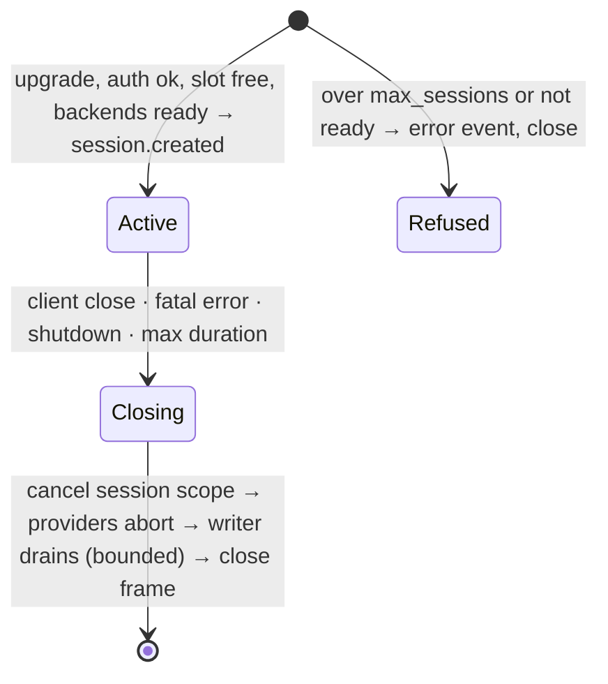
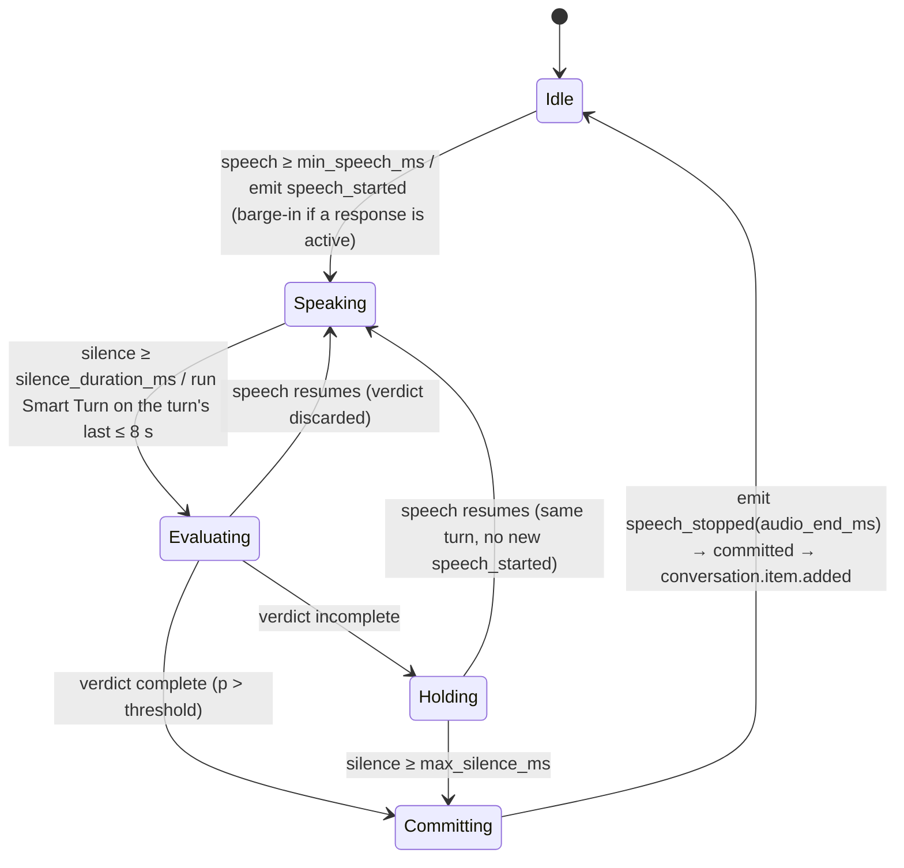
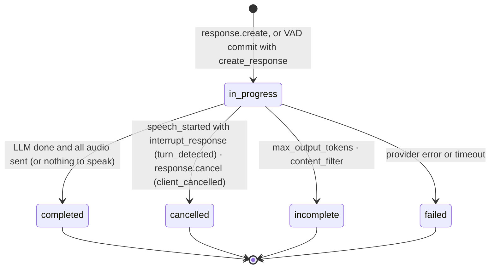

# mlx-realtime — Architecture

> **Status: DRAFT (2026-10-22).** Decisions D1–D19 were approved on 2026-10-22, and D17 was revised the
> same day. Nothing is implemented yet.
> **[M0]** marks a fact or choice that the M0 spikes (`docs/SPIKE.md`) must confirm.
> **[D#]** points to a decision in §12. Milestones are in §13, and sources in §14.

## 1. Purpose and priorities

mlx-realtime is a local voice service for Apple Silicon (M3 Max, 128 GB). Externally it speaks a
documented subset of the OpenAI Realtime API (GA) over WebSocket at `/v1/realtime`; the official
`openai` Python SDK connects by changing only `base_url`. Internally it is a cascade — VAD → turn
detection → ASR → LLM → TTS — for Chinese, English and code-switched speech.

**Clients.**

- **ai-native-callcenter (AICC)** is the integration target. Its existing Realtime client
  (`internal/provider`, GA style) connects to `/v1/realtime` exactly as it connects to OpenAI, and it
  carries FreeSWITCH calls. mlx-realtime attaches first through AICC's existing `gateway` profile,
  with no AICC change, and later through a profile of its own (§2, D11).
- **The official `openai` Python SDK** is the conformance client required by the brief.
- **The benchmark.**

**cascade-realtime-gateway** (`../cascade-realtime-gateway`) is a design reference only, not a client
of this service. mlx-realtime reuses its protocol decisions and lessons where they are GA-faithful.

The protocol layer and the model layer are separated by explicit, swappable interfaces.

When goals conflict they rank:

1. Latency from the end of user speech to the first audio sent.
2. Deterministic barge-in, cancellation and truncation.
3. Reliability: a failed request never takes down its session; a failed session never takes down the process.
4. Observability: every stage of every turn is timed.
5. Single-command deployment.
6. Clear component boundaries.

Out of scope: WebRTC/SIP transports, Docker (Metal is unavailable in containers on macOS), multiple
machines, persistence, server-side tool execution, full Realtime parity.

## 2. Process topology

```
  Realtime clients: ai-native-callcenter (FreeSWITCH calls) · openai SDK · bench
         │ ws://<host>:8000/v1/realtime?model=…   Authorization: Bearer <key>
         ▼
 ┌───────────────── gateway · Python 3.12 · asyncio · uvicorn + starlette ─────────────────┐
 │ WS transport → GA protocol adapter → session actors → per-response pipelines            │
 │ Silero VAD + Smart Turn (onnxruntime, CPU executors)                                    │
 │ resampling · G.711 · sentence segmenter · text normalizer · metrics                     │
 │ /healthz  /readyz  /metrics                          (no MLX installed in this env)     │
 └──────┬──────────────────────────────┬─────────────────────────────────┬─────────────────┘
        │ HTTP                         │ HTTP + SSE                      │ HTTP, chunked PCM
        ▼                              ▼                                 ▼
 ┌──────────────────┐        ┌────────────────────┐          ┌───────────────────────────┐
 │ asr   :8102      │        │ llm   :8101        │          │ tts   :8103               │
 │ Qwen3-ASR-1.7B   │        │ mlx_lm.server      │          │ Qwen3-TTS-0.6B            │
 │ mlx-audio  [M0]  │        │ Qwen3.x-35B-A3B    │          │ + Kokoro-82M fallback     │
 └──────────────────┘        └────────────────────┘          └───────────────────────────┘
   one MLX thread per process; the three processes share the GPU and unified memory
```

| Process | Runs | Owns | Environment | Default bind |
|---|---|---|---|---|
| gateway | `python -m mlx_realtime serve` | protocol, sessions, VAD and turn detection, segmentation, normalization, barge-in, metrics | root uv project; no `mlx*` packages | configurable (AICC runs on another host or in Docker) |
| llm | `mlx_lm.server --model <M0> --chat-template-args '{"enable_thinking":false}' --max-tokens … --temp … --top-p … --top-k …` | LLM weights, KV and prompt cache | `backends/llm` uv project (mlx-lm ≥ 0.32.0) | 127.0.0.1:8101 |
| asr | `mlx_audio.server`, or a thin worker if G1 says so [M0] | ASR model | `backends/audio` uv project | 127.0.0.1:8102 |
| tts | `mlx_audio.server`, or a thin worker if G1 says so [M0] | TTS primary and fallback | `backends/audio` uv project | 127.0.0.1:8103 |

**What the desk check found** (mlx-lm 0.32.2, mlx-audio 0.6.1; M0 confirms each item hands-on):

- **Both backends keep MLX on one thread.**
  - `mlx_lm.server` runs every MLX call on a single generation thread and batches requests
    continuously.
  - `mlx_audio.server` serializes HTTP inference on one broker thread. Its WebSocket routes and
    `POST /v1/models` run MLX on the asyncio thread instead, so the gateway uses only its HTTP routes.
- **`mlx_audio.server` loads each requested model lazily** and has no preload or pinning. The gateway's
  warmup request is what loads the model.
- **mlx_lm.server's generation thread can die,** and nothing restarts it. `/health` then returns 503,
  and the supervisor must restart the process.
- **Running several MLX processes on one GPU has open bug reports:** occasional hangs, and IOGPU
  kernel panics on macOS 26 under high memory pressure. The supervisor therefore restarts any backend
  that fails its health check or stalls a request. M0 runs a soak test before we commit to three
  processes.

**Separate environments [D10].** Each `backends/<role>/` is an independent uv project.

- It is created with `uv init --no-workspace`, and has its own `uv.lock` and uv-managed environment.
- It is started with `uv run --locked --project backends/<role> …`.
- The gateway environment does not contain `mlx`, `mlx-lm` or `mlx-audio`. "The gateway loads no MLX
  models" therefore holds by construction.
- mlx-lm and mlx-audio can pin different `mlx`/`transformers` versions without a resolver conflict.
- The uv rules for the whole repository are in §3.

**The model processes are internal.**

- They bind to 127.0.0.1, and their only client is the gateway's providers (§5). Their HTTP
  contracts (§5.3) are whatever those backends already speak, so nothing outside this repository
  depends on them.
- Thinking is off server-wide (`--chat-template-args`) and again per request, so neither setting alone
  can turn it back on.

**AICC integration [D11].** AICC attaches a Realtime engine as a profile.

- mlx-realtime targets the traits of AICC's existing `gateway` profile, so the first integration needs
  no AICC change at all:
  - `AICC_PROVIDER=gateway`
  - `AICC_PROVIDER_ENDPOINT=ws://<host>:8000/v1/realtime`
  - `REALTIME_API_KEY=<key>`
- A dedicated profile can come later; AICC adds it in its own repository. It would enable G.711
  passthrough (after M7) and `tool_choice`.

AICC's client requirements, from an audit of its `internal/provider` on 2026-10-22. Its client
frames are in `spikes/aicc/traces/`.

| Area | Requirement |
|---|---|
| Handshake | The upgrade completes within 3 s, and `session.updated` arrives within 3 s of the first `session.update`. No `error` may come before it, or the call fails. |
| Session shape | GA, with `audio/pcm` at 24 kHz both ways. `turn_detection` carries only `{type: server_vad, silence_duration_ms: 500}`, so every other field takes its default. Tools are flat function tools. An optional flow-chosen `voice` must never be rejected. Later updates carry only `instructions`. |
| Turn-taking | AICC never commits and never requests a reply to caller speech. The server emits the speech events and creates exactly one reply per speech turn. A turn without a reply leaves AICC's owed turns held. |
| Deadlines | `response.created` ≤ 3 s after `response.create`. The first `response.output_audio.delta` ≤ 3 s after `response.created`. Gaps between audio deltas < 2 s. A tool-only response reaches `response.done` ≤ 3 s after `response.created`. A missed deadline silently abandons the turn. |
| One response at a time | A second `response.create` is refused with code `conversation_already_has_active_response`, not queued. |
| Barge-in | The server cancels its own response: `speech_started` first, then `response.done{status: cancelled}`. It replies after `speech_stopped`. |
| Client edits | `response.cancel` with no id. `conversation.item.truncate` with the played ms of the response. `conversation.item.delete` for unheard items and for tool calls made in a line's turn. User `input_text` notes (keypress, dead air, system notes). A `function_call_output` whose JSON carries a `hint`. |
| Lines | `response.create {response: {instructions: "Say exactly this, word for word, and add nothing else:\n…"}}`, or the Chinese equivalent. This can arrive on an empty conversation. |
| Transcripts | One `conversation.item.input_audio_transcription.completed` per caller utterance, without being asked. |
| Errors | Only a lost socket is fatal. But an unexpected `error` makes AICC forget an in-flight request, so errors are sent only where required, with OpenAI's codes (D18). |
| Audio | 20 ms appends (960 B), sent continuously, including while the bot speaks; AICC has no echo cancellation. Output deltas can be any whole-sample size and arrive faster than real time; AICC queues up to 30 s of them. |

**Startup, warmup, readiness.**

- Processes start independently, with no start-order dependency, and each backend loads its model at
  start.
- Once a backend answers, the gateway warms its provider:
  - LLM: a one-token completion with the default instructions, which also seeds the prompt cache [M0].
  - ASR: a bundled 1 s clip.
  - TTS: one short Chinese and one English sentence per configured voice, on both primary and fallback.
  - Silero and Smart Turn: one inference each.
- `/healthz` reports whether the gateway's event loop is responsive. It makes no backend calls.
- `/readyz` reports whether every provider is reachable and warmed, with per-backend detail.
- Until the first successful readiness, a new connection receives an `error` event (`server_error`,
  code `not_ready`) and is closed. After that, connections are accepted; backend failures surface per
  response (§8) and on `/readyz`.

**Supervision.**

- `make dev` runs `uv sync --locked`, then `uv run --locked mlxrt dev`, a small supervisor in the
  gateway package. It:
  - reads `config.yaml` and starts the three backends and the gateway;
  - prefixes every output line with the process name;
  - forwards SIGINT/SIGTERM, and exits when any child exits (no restart loop in development).
- For unattended use (optional), `mlxrt launchd` renders one launchd plist per process, with KeepAlive
  and log paths, so a crashed backend restarts on its own without touching the others.

## 3. Repository layout

```
mlx-realtime/
├── CLAUDE.md                 # project rules (uv only)
├── pyproject.toml            # gateway uv project: deps, ruff, pyright, pytest config, [tool.uv] required-version
├── uv.lock                   # committed
├── .python-version           # 3.12, written by `uv python pin`
├── config.yaml               # the single configuration file (§10)
├── Makefile                  # dev, test, test-e2e, lint, fmt, typecheck, models, bench
├── README.md
├── docs/
│   ├── ARCHITECTURE.md       # this file
│   ├── PROTOCOL.md           # GA support matrix: every event and field supported / partial / unsupported (M1)
│   ├── SPIKE.md              # M0 plan, then findings
│   ├── DECISIONS.md          # dated one-line decision log
│   └── LATENCY.md            # latency reports (M6+)
├── src/mlx_realtime/         # the gateway package; never imports mlx*
│   ├── __main__.py           # serve
│   ├── cli.py                # serve | dev (supervisor) | launchd | models (fetch + verify ONNX files)
│   ├── config.py             # load config.yaml, env overrides, validation
│   ├── logs.py               # JSON log formatter; contextvars for session_id, turn_id, …
│   ├── metrics.py            # turn timeline, Prometheus histograms, windowed P50/P95
│   ├── server/               # starlette app, WS transport (reader, single writer), admission, health
│   ├── protocol/             # GA wire layer: decode + validate → commands; facts → events; ids; errors
│   ├── session/              # actor, conversation, input buffer, turn manager, response FSM, pipeline, truncation
│   ├── audio/                # resample.py (the only resampler), g711.py, codec.py (wire format ↔ canonical PCM)
│   ├── vad/                  # silero.py, smart_turn.py, whisper_features.py (numpy), executors.py
│   ├── text/                 # segmenter.py, normalize/ (numbers, money, dates, phones, ids), lang.py
│   └── providers/            # base.py (interfaces, types, errors), registry.py, mock.py, mlx_lm_chat.py (LLM),
│                             # mlx_audio_asr.py, mlx_audio_tts.py, fallback.py
├── backends/                 # model processes; each a standalone uv project (uv init --no-workspace)
│   ├── llm/                  # pins mlx-lm; runs mlx_lm.server
│   │   ├── pyproject.toml
│   │   ├── uv.lock
│   │   └── .python-version
│   └── audio/                # pins mlx-audio; runs the ASR and TTS processes
│       ├── pyproject.toml
│       ├── uv.lock
│       ├── .python-version
│       └── src/mlxrt_audio/  # thin workers, only if M0 shows mlx_audio.server is not enough
├── models/                   # ONNX files (Silero, Smart Turn) + manifest with source revision and sha256; files git-ignored
├── deploy/launchd/           # plist templates (optional)
├── tests/
│   ├── unit/                 # codecs, resampling, segmenter, normalizer, input buffer, turn manager, truncation, protocol
│   ├── integration/          # in-process server + mock providers: golden traces, causal invariants, cancellation matrix
│   ├── golden/               # golden JSONL event traces
│   └── e2e/                  # official openai SDK against the full local stack (pytest marker: e2e)
├── bench/
│   ├── bench.py              # replay a WAV directory at real-time speed; per-stage times, P50/P95, CER
│   ├── cer.py
│   └── README.md             # dataset layout: wav + reference text, incl. 8 kHz telephone samples
└── spikes/                   # M0 throwaway scripts and raw results; each spike a standalone uv project with its uv.lock
```

**Dependencies and environments: uv only** (rules in `CLAUDE.md`).

- Every environment is a uv project. Nested ones are created with `uv init --no-workspace`, so the
  gateway, LLM, audio and spike environments resolve independently.
- Dependencies change only through `uv add`, `uv add --dev` and `uv remove`. Environments are built
  with `uv sync`, and everything runs with `uv run`.
- Every `uv.lock` and `.python-version` is committed.
- Automated runs (`make dev`, launchd, CI) use `--locked`.
- There is no pip, no `python -m venv` and no `requirements.txt`.
- `[tool.uv] required-version = ">=0.13.5"` pins the minimum uv release.

## 4. Gateway internals

### 4.1 Layers and import rules

```
server/              transport: WS accept, auth, admission, reader task, single writer task, HTTP endpoints
   │ client event dicts                       ▲ server event dicts
protocol/            GA validation → Commands · Facts → GA events · ids · error mapping   (spec: docs/PROTOCOL.md)
   │ Commands                                  ▲ Facts
session/             actor: Conversation · InputBuffer · TurnManager · Response FSM · truncation
   │ starts one pipeline per response
session/pipeline.py  LLM → segmenter → normalizer → TTS → output encoder
   │
providers/           ASR · LLM · TTS interfaces; HTTP implementations; mocks
```

Internal state is authoritative; protocol events are a projection of it. Import rules:

- `session` imports neither `protocol` nor `server`.
- `providers` imports none of `session`, `protocol` or `server`.
- `audio`, `text` and `vad` are leaf modules.
- Nothing in `src/` imports `mlx*`.

These rules are enforced by an import-graph test and by ruff's banned-imports rule.

### 4.2 Concurrency model

**Scopes.**

- One process, one asyncio event loop.
- Each session runs in its own `asyncio.TaskGroup` (the session scope): WS reader, writer, actor and
  VAD feeder.
- Each response runs in a child TaskGroup (the response scope): LLM reader, segmenter/normalizer, TTS
  and encoder.
- No task lives outside a scope.

**The actor is the only code that mutates session state.**

- Its inbox carries Commands (from the protocol layer) and Signals (results posted back by the VAD
  feeder, the executors and pipeline tasks). It emits Facts, which the protocol layer turns into GA
  events.
- A fourth per-session task ends the session on shutdown or at `max_session_s`.
- Handlers are synchronous; there is no `await` inside a handler. Every command or fact is therefore
  applied atomically within one event-loop step, which is what makes barge-in deterministic (§6.5).
- Pipeline facts carry their response's generation number. The actor drops facts from an older
  generation at ingress.
- Terminal events (`*.done`, `response.done`) are emitted by the actor at the FSM transition, never by
  pipeline tasks.

**Ordering and output.**

- The WS reader puts audio appends and commands into the same FIFO inbox, so `append → commit` and
  `clear → append` apply in the order they were sent.
- All socket writes go through one writer task per session. It counts the audio bytes it writes per
  assistant item; the actor reads that count.

**CPU inference runs off the loop.** onnxruntime releases the GIL inside `run()`.

- Silero runs on a single-thread executor, one call per 32 ms frame. Batching all ready streams into one
  call is an M6 optimization if loop lag shows up.
- Smart Turn runs on its own executor with K workers.
- Results return to the actor as Facts.

**Backends are shared by all sessions.** The gateway drains backend streams promptly and buffers in its
own memory under explicit caps (§4.4). A slow client can never stall a model process that other
sessions depend on.

### 4.3 Audio path

```
input   audio/pcm 24 kHz s16le ───────────────────────┐
        audio/pcmu | audio/pcma ─── G.711 LUT decode ──┤  (8 kHz assumed [D3]; M7)
                                                       ▼
                      soxr ResampleStream → 16 kHz mono int16 (canonical)
                                                       │
                     echo canceller (AEC) ◄── reference: our own output, resampled to 16 kHz
                                                       │      and placed on the modelled client
                                                       │      playout timeline (§6.5)
             ┌──────────────────────────┬──────────────┴───────────────────┐
             ▼                          ▼                                  ▼
     Silero VAD                  Smart Turn v3.2                      InputBuffer
     512-sample frames           last ≤ 8 s of the turn,              committed span → ASR
     (+64-sample context,        front-padded with zeros,             (whole turn, 16 kHz)
      state [2,1,128])           Whisper log-mel [80×800]

output  TTS PCM (model rate, 24 kHz expected [M0]) → resample if needed → encode (PCM16 | G.711)
        → base64 → response.output_audio.delta
```

**One canonical internal format.** Audio is held as 16 kHz mono int16 and converted to float32 only at
model inputs, so wideband and telephony input share one code path.

- Silero has a native 8 kHz mode, but upsampling 8 → 16 kHz once is simpler, and pipecat does the same
  for Smart Turn. M0 compares the two paths for Silero.

**Conversion modules.**

- `audio/resample.py` is the only module that changes sample rates. It keeps one stateful
  `soxr.ResampleStream` (quality HQ) per stream and direction, and flushes it at stream end.
- `audio/g711.py` implements μ-law and A-law with lookup tables: 256 entries to decode, 65 536 to
  encode. It is tested exhaustively against `audioop`, which still exists (deprecated) in Python 3.12;
  there is no runtime dependency on `audioop`.

**Model-side code is vendored, not installed.**

- `vad/silero.py` ports pipecat's ~90-line numpy wrapper around the vendored `silero_vad.onnx`. The
  official `silero-vad` package requires torch.
- `vad/whisper_features.py` ports pipecat's numpy Whisper log-mel, parity-tested against
  `transformers`, which is a test-only dependency.

**Output chunking.** Output deltas are re-chunked to at most `max_delta_ms` (default 100 ms).

### 4.4 Queues and backpressure

| Buffer | Bound | When full |
|---|---|---|
| inbound WS message | `client_max_message_bytes` = 16 MiB (the GA append limit is 15 MiB) | close 1009 |
| session inbox (appends + commands) | `inbox_max_ms` of audio (2 s) + 256 commands | fatal `input_queue_overflow`: `error` event, close 1011. Audio is never dropped silently |
| InputBuffer | `input_audio_buffer_max_ms` (60 s); idle audio trimmed in VAD modes (§6.2) | fatal `input_audio_buffer_overflow` |
| LLM stream | drained immediately; text bounded by `max_output_tokens` | — |
| TTS audio per response | `max_response_audio_ms` (120 s) | response ends `incomplete` |
| outbound events per session | 256 events | Pipeline producers wait once half the queue is full; the actor never waits. A backlog over the limit, or a write stalled longer than `client_write_timeout` (5 s), closes the session (1008, `slow_client`) |
| backend in-flight requests | per-backend semaphore + `queue_timeout` | response `failed`, `error` code `backend_busy` |

## 5. Provider interfaces

### 5.1 Interfaces

```python
# src/mlx_realtime/providers/base.py — sketch
from collections.abc import AsyncIterator, Sequence
from dataclasses import dataclass
from typing import Literal, Protocol

@dataclass(frozen=True, slots=True)
class Transcript:
    text: str
    language: str | None          # if the model reports it [M0]
    audio_ms: int

@dataclass(frozen=True, slots=True)
class TextDelta:
    text: str                     # never contains tool-call markup or reasoning

@dataclass(frozen=True, slots=True)
class ToolCall:                   # always complete; fragments are assembled inside the provider
    call_id: str                  # provider-side id; the protocol layer mints the wire call_id
    name: str
    arguments: str                # raw JSON text; the gateway never parses it

@dataclass(frozen=True, slots=True)
class LLMDone:
    finish_reason: Literal["stop", "length", "tool_calls", "content_filter"]
    usage: Usage | None

Delta = TextDelta | ToolCall | LLMDone

@dataclass(frozen=True, slots=True)
class PCMChunk:
    pcm: bytes                    # s16le mono
    sample_rate: int

class ASRProvider(Protocol):
    async def transcribe(self, pcm16_16k: bytes, *, language: str | None = None) -> Transcript: ...

class LLMProvider(Protocol):
    def stream(self, messages: Sequence[Message], tools: Sequence[ToolDef], *,
               tool_choice: ToolChoice = "auto",
               max_output_tokens: int | None = None) -> AsyncIterator[Delta]: ...

class TTSProvider(Protocol):
    def stream(self, text: str, voice: str, lang: Lang, *,
               speed: float = 1.0) -> AsyncIterator[PCMChunk]: ...

class Backend(Protocol):          # every provider also implements this
    async def warmup(self) -> None: ...
    async def ready(self) -> Readiness: ...
    async def aclose(self) -> None: ...
```

The three method signatures are the brief's. The keyword-only options (`language`, `tool_choice`,
`max_output_tokens`, `speed`) are additions.

### 5.2 Contracts

**Cancellation.**

- The only mechanism is cancelling the consuming task, or calling `aclose()` on the iterator.
- A provider must let `CancelledError` propagate.
- It must abort its backend request in `finally` without awaiting anything that can block; closing the
  HTTP response closes the connection.
- It must yield nothing after cancellation.
- Every provider has a cancellation test at each await point.
- M0 checks whether each backend stops computing when the connection closes. Where one does not, the
  wasted GPU time is measured and reported.

**Deadlines.**

- Every request has a `connect_timeout`, a `first_item_timeout` (first token, first audio or
  transcript), an `idle_timeout` between items and a `total_timeout`.
- Expiry raises `ProviderTimeout`. Nothing waits without a deadline.

**Errors.**

- Providers raise `ProviderError(kind, retryable)`, where `kind` is one of `unavailable`, `timeout`,
  `overloaded`, `bad_response` or `internal`.
- Providers never emit protocol events or touch session state; the actor maps errors (§8).

**Normalization at the boundary.** Backend quirks stay inside the providers.

The LLM provider (mlx-lm 0.32.2):

- **`model` field.** It sends the exact `--model` string, or omits the field. Any other value makes
  `mlx_lm.server` look the name up on HF and swap models.
- **Message shape.** It always produces a messages list the Qwen chat template accepts; a template
  error comes back as HTTP 404.
  - The system message comes first.
  - System items created later in the conversation are folded into a user-role message with a marker
    [M5].
  - There is always at least one user message. An empty conversation, such as a greeting requested
    with `response.create`, gets a short configurable synthetic cue.
- **`tool_choice`.** The server ignores `tool_choice` and `parallel_tool_calls`, so the gateway
  enforces them:
  - `none` sends no tools at all;
  - `auto` sends the session tools;
  - `required` and a forced function are rejected as unsupported until M5 decides.
- **Tool calls.** They arrive from the server already parsed (Qwen3.6's template uses the qwen3_coder
  XML format, and the server's parser types the arguments from the JSON schema), one complete call per
  delta. A `finish_reason: tool_calls` with no parsed call means the server dropped a malformed call.
  The provider reports that as `bad_response`; it never delivers a partial call.
- **Thinking.** `delta.reasoning` is dropped; it should never appear while thinking is off.

**TTS fallback.** `FallbackTTS(primary, fallback)` wraps two providers.

- If the primary fails before its first chunk of a segment, that segment is retried on the fallback
  with a mapped voice.
- A failure after audio has started fails the segment; the voice never switches mid-sentence.
- After N consecutive primary failures, a circuit breaker uses the fallback for `cooldown_s`.

### 5.3 Backend wire contracts

These are desk-verified against the source of mlx-lm 0.32.2 and mlx-audio 0.6.1, and confirmed
hands-on in M0.

| Role | Request | Response | Readiness |
|---|---|---|---|
| LLM (`mlx_lm.server`) | `POST /v1/chat/completions`: `messages`, `stream: true`, `stream_options: {include_usage: true}` (sending `stream_options` without that key fails mid-stream), `max_completion_tokens`, `temperature`, `top_p`, `tools`, `chat_template_kwargs: {enable_thinking: false}`; no `seed` (it disables batching) | SSE `data:` chunks whose deltas carry `content`, `reasoning` or `tool_calls`. A usage chunk, with `cached_tokens`, precedes `[DONE]`. `: keepalive` comment lines arrive during prefill | `GET /health` (503 once the generation thread has died) |
| ASR (`mlx_audio.server`) | `POST /v1/audio/transcriptions`, multipart: `file` (WAV, 16 kHz mono s16), `model`, `language` (omit for auto-detect), `response_format: verbose_json` | JSON `text`, `language`, `segments`. No word timestamps | `GET /v1/models` plus the warmup request |
| TTS (`mlx_audio.server`) | `POST /v1/audio/speech`, JSON: `model`, `input`, `voice`, `lang_code` (`chinese` / `english` / `auto`), `response_format: "pcm"`, `stream: true`, `streaming_interval` | chunked body of raw s16le mono at 24 kHz, one chunk per `streaming_interval × 12.5` codec frames (80 ms each). Without `stream: true` nothing arrives until synthesis ends | as ASR |

Behaviour each contract implies:

- **Cancellation.** Closing the HTTP response is the cancel signal.
  - `mlx_lm.server` stops at the next token once a write fails. It cannot notice a disconnect while
    it streams nothing, which happens during a tool-call span and, on its sequential path, during
    prefill.
  - `mlx_audio.server` stops between chunks.
- **Model choices for M0** (all checked to exist on HF, 2026-10-22):
  - LLM: `mlx-community/Qwen3.6-35B-A3B-4bit` and `mlx-community/Qwen3.5-35B-A3B-4bit`, 20.4 GB each,
    model_type `qwen3_5_moe`, hybrid thinking.
  - ASR: `mlx-community/Qwen3-ASR-1.7B-8bit` (2.5 GB).
  - TTS: `mlx-community/Qwen3-TTS-12Hz-0.6B-CustomVoice-8bit` (2.0 GB).
  - TTS fallback: `mlx-community/Kokoro-82M-bf16` (0.4 GB).
  - Qwen publishes no official MLX build of 3.5 or 3.6.

### 5.4 Implementations by milestone

| Milestone | Implementations |
|---|---|
| M1 | Mocks: `EchoLLM` echoes the last user text, `SineTTS` returns a sine tone whose length scales with the text, `ScriptedASR` returns scripted transcripts. |
| M2 | `MlxLmChatLLM` → llm process; `MlxAudioASR` → asr process. |
| M3 | `MlxAudioTTS` → tts process; `FallbackTTS`. |
| M5 | Tool calls taken from the server's own parser, replayed in history, with `tool_choice` enforced in the gateway. |

## 6. Session state machine

### 6.1 Session lifecycle



While a session is Active, its actor owns:

- the session config, GA-shaped. A `session.update` is validated as a whole, then merged field by field.
- the Conversation, an ordered list of items.
- the InputBuffer.
- the TurnManager.
- at most one in-progress Response.

`session.created` echoes the full effective session, including `id` and `object: "realtime.session"`,
which the GA reference requires and the SDK's push-to-talk example asserts on.

### 6.2 Turn detection

**`turn_detection: null`.** No VAD or Smart Turn runs and no speech events are emitted. Commit and
response creation are entirely client-driven.

**Other modes.** `semantic_vad` and any unknown type are rejected with an `error` (`invalid_value`,
`param: "session.audio.input.turn_detection.type"`).

**`server_vad` = Silero VAD + Smart Turn [D4].** The GA fields map as follows:

| GA field (GA default) | Meaning here |
|---|---|
| `threshold` (0.5) | Silero speech probability needed to enter speech; exit at `threshold − 0.15`, Silero's own hysteresis |
| `prefix_padding_ms` (300) | audio kept before the detected start; included in the committed item and in `audio_start_ms` |
| `silence_duration_ms` (500) | silence after speech that triggers a Smart Turn evaluation; our session default is 200 (pipecat's VAD `stop_secs` with Smart Turn) |
| `create_response`, `interrupt_response` (true, true) | as GA, and independent of each other: with `create_response: false` the commit still happens |
| `idle_timeout_ms` (null) | only `null` accepted for now |

**Server-side knobs.** These live in `config.yaml`, not in the protocol:

- `min_speech_ms`: speech required before `speech_started`, so clicks and short noises do not barge in.
- `smart_turn.enabled`.
- `smart_turn.model`: the int8 "cpu" file or the fp32 file [D9].
- `smart_turn.threshold`: 0.5, the reference value.
- `smart_turn.max_silence_ms`: commit anyway after this much silence when the model keeps saying
  "incomplete" (pipecat uses 3 s).



**What the client sees.**

- Exactly one `speech_started` / `speech_stopped` pair per user turn.
- `speech_stopped` is immediately followed by `input_audio_buffer.committed`, as with GA `server_vad`.
- `audio_end_ms` is the acoustic end of speech. The time the decision took is recorded as the
  `turn_confirmed` stage.

**Other rules.**

- With `smart_turn.enabled: false`, Evaluating goes straight to Committing, which is plain
  silence-based VAD.
- When no speech is in progress, the InputBuffer keeps only `prefix_padding_ms` plus one frame. A caller
  on hold who streams silence never overflows it (a lesson from cascade).
- Smart Turn sees at most the last 8 s, but the ASR receives the whole committed turn.

**A server_vad turn, as the client sees it [D7]:**

```
speech_started → speech_stopped → committed → conversation.item.added → response.created
→ conversation.item.input_audio_transcription.completed → conversation.item.done
→ response.output_item.added → … (§6.3)
```

This is the order OpenAI and cascade use, and the one AICC was built against.

### 6.3 Response lifecycle



**States and flags.**

- Only the five protocol states exist.
- Progress within `in_progress` is tracked by flags: `awaiting_transcript`, `llm_done`, `tts_done` and
  `audio_sent`. There are no extra states.
- One response at a time: a `response.create` while one is in progress gets an `error`
  (`invalid_request_error`, code `conversation_already_has_active_response`). It is not queued.

**When a response is created.**

- Either trigger creates the response immediately: a client `response.create`, or a VAD commit with
  `create_response`. The LLM starts once the transcript of the latest committed user item is final.
- If that transcript is empty or whitespace (noise), the response completes at once with no output
  and no LLM call [D7]. A client that waits for one reply per speech turn, as AICC does, is still
  released.
- With AICC's 3 s first-audio deadline starting at `response.created`, the budget has to cover ASR +
  LLM TTFT + the first segment + the TTS first chunk (G4).

**Audio response events, in order.** This is the GA guide's lifecycle order, also used by cascade's
approved profile.

```
response.created → response.output_item.added → conversation.item.added → response.content_part.added
→ {response.output_audio_transcript.delta | response.output_audio.delta}*
→ response.output_audio.done → response.output_audio_transcript.done
→ response.content_part.done → response.output_item.done → conversation.item.done → response.done
```

With `output_modalities: ["text"]` [D12], `response.output_text.delta` / `.done` replace the audio and
transcript events.

### 6.4 Items

| Item | Created | Done |
|---|---|---|
| user audio message | at commit: `conversation.item.added` (`status: in_progress`, transcript null) | when the transcript is final: `conversation.item.input_audio_transcription.completed` (if transcription is enabled), then `conversation.item.done` |
| client-created item (`conversation.item.create`) | `conversation.item.added` | `conversation.item.done`, immediately after |
| assistant message | lazily, on the first text delta, so a call-only response has no empty message item | with the response; `incomplete` if interrupted |
| function call | when a complete call arrives (§6.7) | immediately |

`conversation.item.created` is never emitted [D1]. The GA guides answer item creation with
`conversation.item.added` → `conversation.item.done`. The legacy event is still in the SDK's union, and
the SDK parses either.

### 6.5 Barge-in and cancellation

**Trigger.** A `SpeechStarted` fact arrives while a response is `in_progress` and `interrupt_response`
is true. The actor then runs one synchronous handler, and nothing else runs between its first and last
step:

1. Emit `input_audio_buffer.speech_started`, with `audio_start_ms` and the `item_id` of the user item
   the commit will create.
2. Cancel the response scope: the LLM, segmenter, TTS and encoder tasks. `Task.cancel()` returns at
   once; the tasks unwind afterwards and their providers close the backend requests.
3. Bump the response generation, so late facts from the old pipeline are dropped at ingress.
4. Flush unsent output audio. Queued audio deltas carry their generation, and the writer discards
   stale ones.
5. Record `sent_ms` for the assistant item: the audio actually handed to the socket.
6. Emit terminal events for every open stream, in this order:
   - `response.output_audio.done`
   - `response.output_audio_transcript.done`, whose transcript is the text whose audio was sent
   - `response.content_part.done`
   - `response.output_item.done`, with the item `incomplete`
   - `conversation.item.done`
   - `response.done` with `status: cancelled` and `status_details: {type: cancelled, reason: turn_detected}`
7. Mark the assistant item for truncation (§6.6).

**Other triggers use the same handler.**

- `response.cancel`: reason `client_cancelled`, and no `speech_started`.
- Provider failure: status `failed`, plus an `error` event.
- Session close: the scope is cancelled and no events are emitted.
- Interruption while still awaiting the transcript, before any output item exists: only
  `speech_started → response.done{cancelled}`.

**Echo [D17].** Echo cancellation is this service's job.

- AICC streams caller audio continuously, including while the bot speaks.
- Neither AICC nor FreeSWITCH cancels echo on these calls. FreeSWITCH has a Speex-based canceller in its
  `preprocess` application, but it is off by default and not enabled; the owner decided on 2026-10-22
  that the service handles echo.
- A self-cancelling server would therefore interrupt itself on its own echo, and AICC's 800 ms barge
  guard cannot prevent that.

**Echo canceller** (implemented in M4; the engine is chosen in M0). Each session runs an echo
canceller on the canonical 16 kHz input, before VAD, Smart Turn and the InputBuffer, so every consumer
sees cancelled audio.

- **Reference.** The reference is the session's own output audio, resampled to 16 kHz and placed on a
  model of the client's playout:
  - a response's audio starts playing when its first delta reaches the client, after a configurable
    prebuffer (AICC: 3 frames, 60 ms);
  - it then plays continuously at real time;
  - it stops at a barge-in flush. The played position is corrected by the client's
    `conversation.item.truncate` (`audio_end_ms`).
- **Delay.** The canceller, or a gateway-side delay estimator, absorbs the remaining delay: network,
  jitter buffer and echo path. That delay is bounded, unlike the raw send-to-play delay, which grows
  with the client's queue.
- **Runtime.** The canceller runs per session in the CPU executor, on 10 ms frames.
- **Choice.** The algorithm and library are chosen in M0 (G7) from simulated telephone echo built from
  public speech and standard line-echo path models. Live measurement on a real call is deferred.

**Second line of defence.** Both rules stay configurable, because residual and nonlinear echo can
still cross the VAD threshold. While the client is modelled as playing:

- **Onset guard.** For the first `echo_guard_ms` of playback, a speech onset does not trigger
  barge-in. For the rest of playback it needs a longer `min_speech_ms`.
- **Echo-turn suppression.** A committed turn whose transcript matches recent assistant text is
  dropped, so the bot never answers itself.

**Observability.** Per call: the estimated echo return loss enhancement (ERLE), and the number of
barge-ins whose turn turned out to be empty or echo.

**Test coverage.** Tests cover every phase, each with every trigger:

- Phases: awaiting transcript, before the first token, mid-text, mid-tool-call, mid-audio, and draining
  after the LLM is done.
- Triggers: barge-in, `response.cancel`, disconnect, backend error, backend timeout.

Each test asserts that:

- no delta follows a terminal event;
- every opened stream is closed exactly once;
- provider streams are observed closed within a bound;
- the conversation history is consistent.

### 6.6 Truncation

**Segment map.** For each assistant item the actor keeps, per synthesized segment: the original text,
the normalized text, `audio_start_ms`, `audio_ms` and how much of it was sent. All positions are on the
item's output-audio timeline.

**Client truncate.** `conversation.item.truncate {item_id, content_index: 0, audio_end_ms}`:

- applies to assistant message items only;
- truncates in place, including on a completed item (AICC truncates after `response.done`, while its
  queue is still playing);
- if `audio_end_ms` is beyond the audio sent for that item, clamps it to the sent audio and logs a
  warning [D18]. GA says the server responds with an `error`, but AICC treats any truncate error as
  the failure of whatever request it has in flight. AICC's played-ms is counted in whole 20 ms frames
  of audio we sent, so it can overshoot only by rounding.
- then sets the item's effective text to:
  - every segment that ends at or before `audio_end_ms`, plus
  - a proportional prefix of the segment playing at that moment, measured in characters and snapped to
    a word boundary for Latin text;
- then emits `conversation.item.truncated`. The next LLM request sees only the effective text.

**Fallback when the client sends no truncate [D5].** Before building the next LLM request, the actor
applies a fallback cut.

- The brief specifies "the duration the server has sent". But over WebSocket audio is sent faster than
  real time (GA: "The server will produce audio faster than realtime"), so after a barge-in `sent_ms`
  can be several times what was actually heard.
- Proposed fallback: `min(sent_ms, time since the item's first audio delta was sent)`.

**Transcript deltas.** A segment's transcript deltas are sent when that segment's audio starts going
out, so the client's transcript follows what it is playing.

### 6.7 Tool calls

**Request side.**

- `session.tools` reach the LLM request. `tool_choice` (session-level or per response) is applied by
  the gateway, as described in §5.2.
- The LLM provider yields only complete calls, taken from `mlx_lm.server`'s parsed `tool_calls`.
- Text before a call is spoken normally. Call markup never reaches the segmenter or TTS, because the
  server streams nothing while the model is inside a call.

**Events per call.**

```
response.output_item.added (function_call) → conversation.item.added
→ response.function_call_arguments.delta   (the complete arguments, once)
→ response.function_call_arguments.done → response.output_item.done → conversation.item.done
```

`response.done{completed}` lists the call in `output`.

**Ids.** The protocol layer mints the wire `call_id`; the provider's own id stays internal.

**Round trip.**

1. The client returns `conversation.item.create {type: function_call_output, call_id, output}`.
2. The server answers `conversation.item.added` → `conversation.item.done`.
3. The client sends `response.create`.

History replays the call as an assistant `tool_calls` message followed by a `tool` message.

**Cancellation.** A response cancelled before its call is complete delivers no call, and a call that
has been delivered is never retracted.

## 7. Response pipeline

```
LLM deltas ─► segmenter ─► normalizer ─► TTS (one request per segment) ─► encoder ─► writer
    │             └── original text ──────────────────────────────────► transcript deltas
    └─► complete tool calls ─► actor
```

**Segmenter** (`text/segmenter.py`).

- Hard boundaries: `。！？；!?;`, `…`, newline, and `.` when it is not inside a number, abbreviation,
  URL or ID.
- The first segment may also end:
  - at `，、,：:` once `first_min_chars` is reached, or
  - at the best boundary so far, once `first_max_wait_ms` has passed since the first token.
- Later segments need at least `min_chars`. A segment longer than `max_chars` splits at the nearest
  soft boundary.
- Length counts CJK characters and Latin words.
- It never splits inside a number, decimal, URL, e-mail address or ID.

**Normalizer** (`text/normalize/`). It applies to TTS input only; transcripts keep the original text.

- Categories:
  - numbers: cardinal, decimal and percent, read in Chinese or English depending on context;
  - currency;
  - dates and times;
  - phone numbers, read digit by digit in groups, with `1` read as 幺 if configured;
  - order and tracking IDs, read character by character;
  - units;
  - zh/en spacing.
- Each segment gets a language tag (`zh` or `en`; mixed text is tagged `zh`), which goes to
  `TTSProvider.stream(lang)`.
- M0 measures which categories the TTS already reads correctly; we normalize only where it helps.

**TTS.**

- Segments are synthesized in order, one request each.
  - Qwen3-TTS prefills the whole text before it produces audio, so input cannot be streamed into a
    request.
  - Streamed requests are never batched.
- The next request starts as soon as the previous one has finished generating, not when its audio has
  finished playing.
- The LLM keeps decoding on the same GPU in the meantime. M0 measures that contention; MLX has no
  queue-priority API.
- Qwen3-TTS 0.6B CustomVoice parameters:
  - speakers: `vivian`, `serena`, `uncle_fu`, `dylan`, `eric`, `ryan`, `aiden`, `ono_anna`, `sohee`;
  - languages: `auto`, `chinese`, `english`, … (an unknown code silently becomes `auto`);
  - no `speed`, and no `instruct` on 0.6B.
- `audio.output.voice` names a speaker. An unknown name is accepted, mapped to the configured default
  voice, and logged as a warning; the effective voice is echoed back [D19]. AICC passes a flow-chosen
  name and keeps it on retry, so rejecting a name would fail every call of that flow.

**Verbatim lines [D16].** If a response's instructions start with a configured direction prefix, the
server skips the LLM and speaks the rest of the text as written. The default prefixes are AICC's
"Say exactly this, word for word, and add nothing else:\n" and its Chinese equivalent.

- The text becomes the assistant message.
- This makes AICC's greetings, announces, wait lines and closing lines exact.
- Their latency drops to the TTS first chunk, with no prefill of a changed system prompt.
- Any other `instructions` override replaces the session instructions for that response, as GA
  specifies.

**Encoder.** It resamples and encodes to the session's output format, in deltas of at most
`max_delta_ms`.

**Pacing [D6].** Audio is sent as soon as it is available, as GA does over WebSocket, but never more
than `max_lead_ms` ahead of real time. The default cap is 10 s.

- The cap bounds the client's queue; AICC queues at most 30 s and drops the rest.
- It also keeps a cancelled response's unsent audio on the server, where the barge-in flush removes it.
- Sends stay small and steady, so the gap between deltas never approaches AICC's 2 s watchdog.

## 8. Reliability

**Isolation.**

- A session's tasks all live in its scope. An unexpected exception closes that session only (`error`
  with `server_error`, close 1011) and is logged with the session's ids.
- A failed response fails only that response.

**Admission.** A connection over `max_sessions` gets its upgrade accepted, then an `error` (`server_error`,
code `session_limit_reached`), then close 1013 (try again later).

**Backend failure or timeout.**

- The response ends `failed`, with `status_details.error` set.
- An `error` event names the backend and the cause: `backend_unavailable`, `backend_timeout`,
  `backend_busy` or `provider_error`.
- The session stays open. GA: "Most errors are recoverable and the session will stay open."
- An ASR failure emits `conversation.item.input_audio_transcription.failed` for the item, and ends that
  turn's response as `failed`. The client still sees the turn end.

**Backend health.** The gateway keeps a health state per backend, fed by:

- request outcomes;
- stalls: no chunk within `idle_timeout`;
- periodic probes.

`/readyz` reports that state. Restarting a dead or wedged backend is the supervisor's job (launchd
KeepAlive, or `mlxrt dev`), never the gateway's. MLX multi-process hangs and a dead `mlx_lm.server`
generation thread both end up there.

**Error policy [D18].** An `error` event is sent only when the protocol requires one, or when a
client request cannot be honoured. Where OpenAI's live service has a known code that AICC matches,
that code is used:

- `conversation_already_has_active_response`: a `response.create` while a response is active.
- `response_cancel_not_active`: a `response.cancel` with nothing to cancel.
- `param: "item_id"` (code `item_not_found`): an unknown item on `conversation.item.delete` or
  `conversation.item.truncate`.

When a backend fails during a response, the `error` event goes out before `response.done{failed}`, so
AICC ties it to that response. Session-ending codes: `slow_client` (close 1008) and `internal_error`
(close 1011).

Protocol validation otherwise uses `invalid_request_error` with `invalid_event` / `invalid_value` and a
dotted `param`.

Clamping and tolerance are preferred over errors wherever the client cannot do anything useful with
one:

- truncate overshoot (§6.6);
- unknown voices (§7).

**Session lifetime.**

- Fatal for the session: inbound overflow, input-buffer overflow, a client write stall, or an internal
  error.
- Shutdown: stop accepting connections, close sessions with 1001, and let writers drain within a bound.
- Session duration is capped by `max_session_s`; GA sessions last at most 60 minutes.

## 9. Observability

**Ids and logs.**

- Every log record carries these ids through contextvars:
  - `session_id`, which equals `session.id` (`sess_…`);
  - `turn_id` (`turn_…`), one per user turn;
  - `response_id`;
  - `item_id`.
- Logs are JSON lines on stdout, written with stdlib `logging` and a JSON formatter.
- Audio is never logged. Transcripts are logged at debug level only [D8].

**Turn timeline.** Marks are taken on a monotonic clock:

```
speech_end (acoustic, from the audio timeline) · speech_stopped (VAD fired)
→ turn_confirmed → asr_done → llm_first_token → first_sentence_ready → tts_first_chunk → first_audio_sent
```

- Each stage is the difference between consecutive marks.
- End-to-end latency is `first_audio_sent − speech_end`, which is what the user experiences.
- Under manual commit, `committed` stands in for `speech_stopped` and `turn_confirmed`.
- One summary log line per turn carries every mark.

**`/metrics`** (Prometheus text format).

- Histograms: `mlxrt_stage_seconds{stage}` and `mlxrt_e2e_seconds`.
- Counters: sessions, responses by status, barge-ins, and provider errors by backend and kind.
- Gauges:
  - active sessions;
  - backend readiness;
  - windowed P50/P95 per stage (`mlxrt_stage_p50_seconds`, `mlxrt_stage_p95_seconds`) over the last N
    turns.

The Python Prometheus client's `Summary` exposes only count and sum, so quantiles for direct reading are
computed in-process. The histograms remain the aggregatable source.

**Benchmark data [D8].** The benchmark collects each turn's server-side marks from a debug endpoint,
`GET /debug/turns?session_id=…`, which is off by default.

## 10. Configuration

**One file.**

- All configuration lives in `config.yaml`.
- Any key can be overridden by an environment variable `MLXRT__<SECTION>__<KEY>`. A double underscore
  marks nesting, and the value is parsed as YAML.
- Validation runs at startup. An unknown key or a bad value stops startup and names the dotted path.
- Model ids and revisions, ports, thresholds, timeouts and queue bounds all live here.

Sketch (the values are illustrative; real ids and numbers come from M0):

```yaml
gateway:   {host: 127.0.0.1, port: 8000, max_sessions: 8, api_key: "", max_session_s: 3600}
limits:    {client_max_message_bytes: 16777216, inbox_max_ms: 2000, input_audio_buffer_max_ms: 60000,
            outbound_queue_events: 256, client_write_timeout_ms: 5000, max_response_audio_ms: 120000}
output:    {max_lead_ms: 10000, max_delta_ms: 100, default_voice: "<M0>"}
lines:     {verbatim_prefixes: ["Say exactly this, word for word, and add nothing else:\n",
                                "请一字不差地说出下面这句话，不要添加任何其它内容：\n"]}
aec:       {enabled: true, engine: "<M0: G7>", client_prebuffer_ms: 60, max_residual_delay_ms: "<M0>"}
barge_in:  {echo_guard_ms: "<M0>", min_speech_ms_while_playing: "<M0>", echo_turn_suppression: true}
session_defaults:                       # GA-shaped; echoed in session.created
  instructions: "…"
  output_modalities: [audio]
  audio:
    input:
      format: {type: audio/pcm, rate: 24000}
      transcription: {model: qwen3-asr}
      turn_detection: {type: server_vad, threshold: 0.5, prefix_padding_ms: 300,
                       silence_duration_ms: 200, create_response: true, interrupt_response: true}
    output: {format: {type: audio/pcm, rate: 24000}, voice: "<M0>", speed: 1.0}
turn:
  vad:        {model: models/silero_vad.onnx, min_speech_ms: 150}
  smart_turn: {enabled: true, model: models/smart-turn-v3.2-cpu.onnx, threshold: 0.5,
               max_silence_ms: 3000, window_s: 8, workers: 2}
text:
  segmenter:  {first_min_chars: 4, first_max_wait_ms: 400, min_chars: 8, max_chars: 80}
  normalizer: {enabled: true, phone_one_as_yao: true}
providers:
  llm: {type: mlx_lm_chat, base_url: http://127.0.0.1:8101/v1, model: "<M0: repo id + revision>",
        temperature: 0.7, top_p: 0.8, max_context_tokens: 8192, empty_conversation_cue: "…",
        timeouts: {connect_ms: 500, first_token_ms: 5000, idle_ms: 3000}}
  asr: {type: mlx_audio_transcription, base_url: http://127.0.0.1:8102,
        model: mlx-community/Qwen3-ASR-1.7B-8bit}
  tts: {type: mlx_audio_speech, base_url: http://127.0.0.1:8103,
        model: mlx-community/Qwen3-TTS-12Hz-0.6B-CustomVoice-8bit, streaming_interval: "<M0>",
        fallback: {model: "<D13>", voices: {zh: "<M0>", en: "<M0>"}}}
backends:                               # what `make dev` and launchd start; args come from M0
  llm: {project: backends/llm,   port: 8101, args: [--chat-template-args, '{"enable_thinking":false}', "<M0>"]}
  asr: {project: backends/audio, port: 8102}
  tts: {project: backends/audio, port: 8103}
observability: {log_level: info, quantile_window_turns: 200, debug_endpoints: false}
```

## 11. Testing strategy

**Unit.**

- event decoding, validation and encoding, including error `param` paths;
- session merge rules;
- the segmenter: zh, en, mixed, numbers, URLs;
- the normalizer;
- G.711, exhaustively against `audioop` on 3.12;
- resampling: a chunked stream must equal the one-shot result;
- InputBuffer arithmetic;
- TurnManager transitions;
- truncation arithmetic.

**Determinism tooling.**

- an injectable clock;
- a scripted VAD (speech and silence at given audio offsets) and scripted Smart Turn verdicts;
- mock providers with gates (an `asyncio.Event` at each await point), so a test can stop a pipeline at
  an exact phase.

**Integration** (in-process server with mock providers).

- Golden traces for deterministic control sequences: a normal turn, manual commit, barge-in,
  `response.cancel`, truncate, a tool-call round trip, and errors.
- Causal invariants for interleaved audio and transcript streams:
  - `created` comes before any delta;
  - deltas within a stream stay in order;
  - every stream is closed by `done`;
  - nothing follows a cancel.
- The cancellation matrix of §6.5.

**E2E** (pytest marker `e2e`, real backends). The official `openai` SDK (`openai[realtime]`, pinned)
connects with only `base_url` changed and completes one Chinese spoken turn.

**AICC acceptance.**

- **M3, connectivity.** The client frames in `spikes/aicc/traces/` are replayed against the gateway
  as integration tests. AICC's own Realtime client harness (`probe`, `measureResponseCreated`),
  pointed at mlx-realtime, checks the handshake, a spoken turn and the 3 s deadlines.
- **M4, barge-in.** The same harness covers interruption, the truncate and delete flows, and
  behaviour under simulated echo.

**Benchmark** (`bench/`). Replays a WAV directory, including 8 kHz telephone samples, at real-time
speed. It reports each turn's stage durations, P50/P95, and ASR CER.

**Tooling.**

- ruff for format and lint, pyright strict on `src/`, and pytest with pytest-asyncio.
- All of them are dev dependencies of the gateway project (`uv add --dev`), run with `uv run`.
- `transformers` and `openai[realtime]` are test-only dev dependencies, also added with `uv add --dev`.

## 12. Decisions

All approved on 2026-10-22. D17 was revised the same day: FreeSWITCH provides no echo cancellation,
so the service does it. Further dated entries go to `docs/DECISIONS.md`.

| # | Decision | Resolution |
|---|---|---|
| D1 | The brief lists `conversation.item.created`; the GA guides answer with `conversation.item.added` → `conversation.item.done` | Emit `added` / `done`, never `created`. Also emit the events our accepted client events require but the brief does not list: `conversation.item.truncated`, `conversation.item.deleted`, `response.output_item.done`, `response.content_part.done`. |
| D2 | The brief uses the beta format names `pcm16`, `g711_ulaw`, `g711_alaw` | GA names only: `{type: "audio/pcm", rate: 24000}`, `{type: "audio/pcmu"}`, `{type: "audio/pcma"}`. Beta names get an `error`. |
| D3 | The Realtime docs do not state the G.711 sample rate | 8 kHz, the G.711 standard rate. |
| D4 | `server_vad` semantics with Smart Turn | One `speech_started` / `speech_stopped` pair per turn. `silence_duration_ms` is the silence before a Smart Turn evaluation, with a session default of 200 ms (GA default 500). `max_silence_ms` is server-side only. `idle_timeout_ms` accepts only `null`. |
| D5 | Truncation fallback when the client sends no truncate | `min(sent_ms, time since the first audio delta)` instead of plain `sent_ms`. AICC always sends a truncate, so this matters only for other clients. |
| D6 | Output pacing | Send as soon as available, capped at `max_lead_ms` (10 s) ahead of real time. The cap keeps AICC's 30 s queue from overflowing and keeps unsent audio flushable. |
| D7 | When a VAD turn creates its response | At commit, as OpenAI and cascade do and as AICC expects. An empty or noise transcript completes the response with no output and no LLM call, so AICC's held turns are released. |
| D8 | Logging of transcripts; how the bench gets server-side marks | Transcripts at debug level only; marks from `/debug/turns`, off by default. |
| D9 | Smart Turn file | Measure both in M0. The int8 "cpu" file scores 85.8% on the Chinese test set; the fp32 file (named "gpu", but it runs on CPU) scores 90.5%. Prefer fp32 if its M3 Max CPU latency fits the budget. |
| D10 | Separate uv projects for the model processes | Yes (§2). |
| D11 | How AICC attaches | Satisfy AICC's existing `gateway` profile, with zero AICC changes: `CancelsResponseItself` true; `NeedsCueForFirstTurn` false (the gateway inserts its own cue, because the Qwen template needs a user message); `AcceptsG711` false (24 kHz PCM); `TranscribeModel` empty (we transcribe without being asked); `Voice` empty (we never reject one). We additionally accept `response.tool_choice` `none` / `auto`, so a future dedicated AICC profile can enable it, together with G.711 after M7. |
| D12 | `output_modalities: ["text"]`, which adds `response.output_text.*` and is not in the brief | Support it. The SDK's own `examples/realtime/realtime.py` uses a text loop, and it makes M1 and M2 testable without TTS. |
| D13 | TTS fallback (the brief names Kokoro-82M) | Kokoro's Chinese needs `misaki[zh]`, splits only on ASCII punctuation, and probably mispronounces English words inside Chinese. M0 measures it. If it fails, the proposed alternative is a second Qwen3-TTS build (e.g. 0.6B CustomVoice 4-bit) in the same process. Your call; nothing is substituted without approval. |
| D14 | `audio.output.speed` | Qwen3-TTS has no speed control, so only 1.0 is accepted; other values get an `error`. |
| D15 | Transcription events by default | On (the session default sets `audio.input.transcription`). AICC's gateway-style profile sends no transcription field, and it needs the caller's words in its call transcript. |
| D16 | Verbatim lines | When instructions start with a configured direction prefix (AICC's two by default), skip the LLM and speak the text as written. Lines become exact, and their latency drops to the TTS first chunk. |
| D17 | Echo (neither AICC nor FreeSWITCH cancels it on these calls; FreeSWITCH's own canceller is off by default) | The service cancels echo: a per-session echo canceller on the input, referenced to our own output on a modelled client playout timeline (§6.5). M0 (G7) picks the engine on simulated telephone echo. The onset guard and echo-turn suppression stay as a second line. Live echo measurement is deferred. |
| D18 | Error policy | Use OpenAI's live codes where AICC matches them (`conversation_already_has_active_response`, `response_cancel_not_active`). Clamp a truncate that overshoots the sent audio instead of erroring. Send no unsolicited errors, because AICC pins an `error` on whatever request it has in flight. |
| D19 | Unknown `audio.output.voice` | Accept it, map it to the default voice, log a warning, and echo the effective voice. Never reject it. |

## 13. Milestones

The milestones are completed in order, with a stop and report after each one. Each milestone starts
only on the owner's explicit go-ahead.

| Milestone | Scope (brief) | Also lands here |
|---|---|---|
| M0 | Validation: research and spikes, findings in `docs/SPIKE.md` | S11: echo-canceller selection (G7) |
| M1 | Protocol skeleton and mock providers (text echo + sine audio), end to end with the official SDK | D1, D2, D12, D18; `docs/PROTOCOL.md` |
| M2 | VAD + Smart Turn + ASR + LLM: the speech-to-transcript path | D4, D7, D15; the synthetic cue for an empty conversation |
| M3 | Streaming TTS: one full spoken turn | D6, D13, D16, D19. **AICC acceptance, part 1 — connectivity:** the client traces are replayed, and AICC's `probe` harness checks the handshake, a spoken turn and the 3 s deadlines |
| M4 | Barge-in, cancellation and truncate, with full test coverage | D5. **D17 echo cancellation:** the canceller, the reference playout timeline, the onset guard and echo-turn suppression. **AICC acceptance, part 2 — barge-in:** interruption, truncate and delete flows, and behaviour under simulated echo |
| M5 | Tool calling | `tool_choice` enforced in the gateway (§5.2) |
| M6 | Metrics and the benchmark script; first latency report in `docs/LATENCY.md` | — |
| M7 | G.711 8 kHz telephony | Afterwards, AICC can switch to G.711 passthrough with a dedicated profile, written on the AICC side |

## 14. Sources

All checked on 2026-10-22. Scratch copies are in the session scratchpad.

**OpenAI Realtime (GA).**

- Client events: https://developers.openai.com/api/reference/resources/realtime/client-events
- Server events: https://developers.openai.com/api/reference/resources/realtime/server-events
- Guides: https://developers.openai.com/api/docs/guides/realtime-conversations and
  https://developers.openai.com/api/docs/guides/realtime-vad
- The `openapi.yaml` in openai/openai-openapi, at commit 762a1df.

**openai-python v3.36.1** (tag commit 49e6757).

- `src/openai/resources/realtime/realtime.py` L712–722: URL derivation. `http` becomes `ws`, the scheme
  is not forced to `wss`, and `/realtime` is appended.
- The same file, L409–417: lenient event parsing.
- `examples/realtime/push_to_talk_app.py`, `examples/realtime/realtime.py`.
- Probed against a local capture server: `base_url="http://127.0.0.1:8000/v1"` connects to
  `ws://127.0.0.1:8000/v1/realtime?model=…`, with no `OpenAI-Beta` header.

**cascade-realtime-gateway** (design reference). `docs/protocol-profile.md` and `docs/decisions.md`,
used for prior decisions and lessons.

**ai-native-callcenter** (commit 8fabadc).

- `docs/provider-extension.md` and `internal/provider/profile.go`: the profile traits and the GA
  dialect its client speaks.
- `internal/provider/realtime.go`: the handshake, `session.update` shape, deadlines, error
  classification and barge-in. The watchdog is in `watchdog.go`.
- `internal/aicall/session.go`: the 800 ms barge guard, played-time accounting, and the output queue.
- The client frames, captured by running the real client against AICC's fake server, are in
  `spikes/aicc/traces/`.

**mlx-lm v0.32.2** (desk-checked; nothing run).

- `mlx_lm/server.py`: the flags, the honored and ignored request fields, the single generation thread
  with continuous batching, the LRU prompt cache, and stop-on-write-failure cancellation.
- `mlx_lm/models/qwen3_5_moe.py`: the model architecture.
- `mlx_lm/tokenizer_utils.py`: the tool parser is selected from the chat template (qwen3_coder).
- The chat template of `mlx-community/Qwen3.6-35B-A3B-4bit`: `enable_thinking`, and the tool-call
  format.

**mlx-audio v0.6.1** (desk-checked; nothing run).

- `mlx_audio/server.py` and `mlx_audio/server_inference.py`: the routes, `stream`, pcm output, lazy
  model loading, and the serialized broker thread.
- `mlx_audio/tts/models/qwen3_tts/` and `mlx_audio/stt/models/qwen3_asr/`.
- Kokoro's `pipeline.py`.

**MLX v0.32.4.** Wired-memory API. The open issues ml-explore/mlx#3186 (kernel panics) and
Blaizzy/mlx-audio#733 (multi-process hangs).

**Silero VAD v6.2.3** (commit 5cd7945).

- `src/silero_vad/utils_vad.py`: `OnnxWrapper`. Frames are 512 samples at 16 kHz with a 64-sample
  context, and the state is [2,B,128].
- The defaults are those of `get_speech_timestamps` and `VADIterator`. MIT license.

**Smart Turn v3.2.**

- HF `pipecat-ai/smart-turn-v3` at f766f81d: `smart-turn-v3.2-cpu.onnx` (int8) and
  `smart-turn-v3.2-gpu.onnx` (fp32).
- I/O: `input_features` [B,80,800] goes in; `logits` [B,1] comes out, already a sigmoid probability.
- 16 kHz audio, at most 8 s, front-padded. Chinese test-set accuracy is 85.79% (int8) and 90.53% (fp32).
  BSD-2 license.
- The reference code is in github.com/pipecat-ai/smart-turn at 4786657e.

**pipecat v1.13.0.** The VAD + Smart Turn pattern (VAD `stop_secs` 0.2, then Smart Turn; a 3 s
fallback), the numpy Silero wrapper, and the numpy Whisper features.

**Libraries.**

- onnxruntime 1.31.0: `run()` releases the GIL (`onnxruntime_pybind_state.cc` L3100–3108).
- python-soxr 1.1.0: `ResampleStream`, LGPL-2.1-or-later.
- CPython 3.12: `audioop` is deprecated, and removed in 3.13.
- ITU-T G.711.
- prometheus_client 0.26.0: `Summary` has no quantiles.
